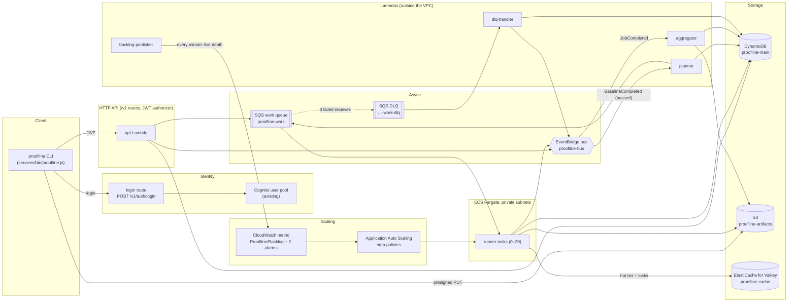
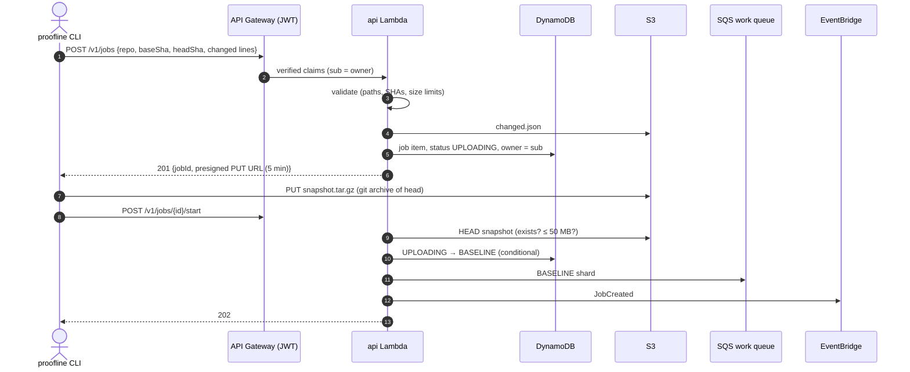
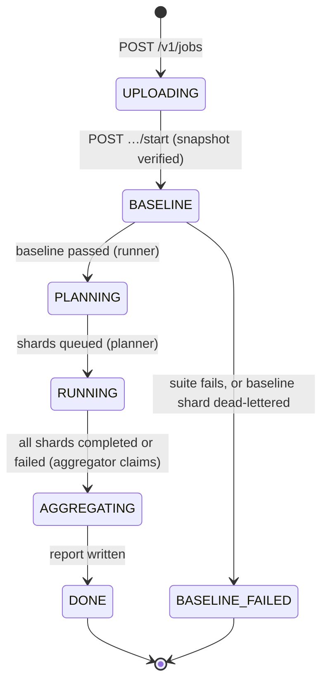
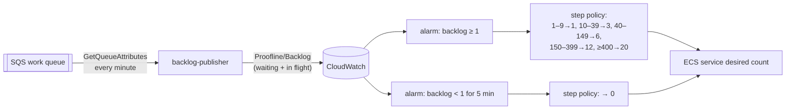

# Proofline — Architecture (as built)

This file describes what is **deployed and working today**: the components, how a job flows through them, the data they share, and how they scale, fail and are observed. Design reasoning, rejected alternatives and plans live elsewhere:

| Document | Contents |
|---|---|
| [`design-doc.md`](design-doc.md) | Requirements, vendor-agnostic design, decision records DR-1–DR-5, account constraints |
| [`future-development.md`](future-development.md) | Dropped and deferred ideas; the roadmap (§D) |
| [`docs/CLI.md`](docs/CLI.md) | User manual for the `proofline` CLI and the sample repos |
| [`report/report.md`](report/report.md) | Technical report: design rationale, evaluation, cost |
| [`evidence/README.md`](evidence/README.md) | Load-test results |

Status markers: ✅ built and verified on AWS · 🔜 designed, not built yet.

---

## 1. What Proofline does

A user submits a **commit range** of a JavaScript/TypeScript repository tested with Vitest. Proofline:

1. runs the project's test suite (the **baseline**) and records which test file executes which line;
2. injects small faults (**mutants**) into the **changed lines only**: `>=` → `>`, `100` → `101`, `return x` → `return undefined`, and so on;
3. re-runs only the tests that cover each mutated line, in parallel on auto-scaled containers;
4. checks the changed lines against static rules (dynamic code evaluation, shell and HTML injection, committed credentials, complexity, …);
5. assesses the change against the **Proofline Verification Framework (PVF 1.0)**: each changed file gets an achieved and a required assurance level (PV-1 to PV-4), and the change gets a verdict, `PASS` or `FAIL`. The report also keeps the mutation-testing detail and a risk tier (LOW / MEDIUM / HIGH / INCONCLUSIVE), and the assessment can be exported as SARIF.

Every finding carries a reproducible **witness**, such as a surviving mutant's exact diff or the line that calls `eval`, so it's evidence, not an opinion. That's the product's core idea. PVF is specified in [`docs/framework.md`](docs/framework.md).

---

## 2. System overview



| Layer | Component | Runs on | Role |
|---|---|---|---|
| Client | `proofline` CLI ✅ | User's machine | Login, submit a commit range, poll, print the report |
| Identity | Cognito user pool ✅ | Managed | Users and ID tokens (an existing pool, shared with other applications) |
| API | `proofline-api` ✅ | Lambda, 512 MB, 15 s | Create / start / read jobs; issues presigned upload URLs |
| Control | `proofline-planner` ✅ | Lambda, 1024 MB, 120 s | Mutants, test selection, cache lookups, shard queueing |
| Control | `proofline-aggregator` ✅ | Lambda, 256 MB, 60 s | Score, risk tier, report |
| Control | `proofline-dlq-handler` ✅ | Lambda, 256 MB, 30 s | Closes out jobs whose shards failed 3 times |
| Scaling | `proofline-backlog-publisher` ✅ | Lambda, 128 MB, every minute | Publishes the live queue depth for the alarms |
| Workers | `proofline-runner-service` ✅ | ECS Fargate, 1 vCPU / 2 GB, 0–20 tasks | **The only place repository code executes** |
| Storage | `proofline-main` ✅ | DynamoDB, on-demand | Jobs, shards, mutant results, durable result cache |
| Storage | `proofline-artifacts` ✅ | S3 | Snapshots, coverage maps, logs, reports |
| Messaging | `proofline-work` + DLQ ✅ | SQS | Work shards; redrive after 3 receives |
| Messaging | `proofline-bus` ✅ | EventBridge | Lifecycle events between components |
| Caching | `proofline-cache` ✅ | ElastiCache for Valkey, `cache.t4g.micro`, port 3001, TLS + auth token | Hot result tier and single-flight locks; runners only (Lambdas can't join the VPC) |
| Secrets | `proofline-cache-auth` ✅ | Secrets Manager | The Valkey auth token, read by the runners |
| Edge | CloudFront for reports / web page 🔜 | CloudFront | design-doc §9 |

Everything is in `ap-southeast-2`, named `proofline-*` (the prefix is configurable), and carries the configured tags. `infra/audit-tags.js` checks all 34 resources.

---

## 3. A job, end to end

### 3.1 Submission (synchronous, ~1 s)



The code never passes through the API Lambda: the client uploads straight to S3 with a URL that's valid for 5 minutes and only for that one object.

### 3.2 Processing (asynchronous)

```mermaid
sequenceDiagram
  autonumber
  participant Q as SQS
  participant R as runner (Fargate)
  participant D as DynamoDB
  participant S as S3
  participant B as EventBridge
  participant P as planner Lambda
  participant A as aggregator Lambda

  Q->>R: BASELINE shard
  R->>S: download + extract snapshot, link prebuilt node_modules
  R->>R: full suite ×2 (flaky check), then each test file with V8 coverage
  R->>S: coverage/<jobId>.json (line → test files)
  R->>D: BASELINE → PLANNING
  R->>B: BaselineCompleted {passed: true}
  B->>P: rule: BaselineCompleted, passed = true
  P->>P: mutants on changed lines; tests per mutant; content-addressed keys
  P->>D: batch-get CACHE# keys
  P->>D: results for cache hits + uncovered mutants
  P->>D: shardsTotal, PLANNING → RUNNING (conditional)
  P->>Q: MUTANTS shards (≤ 10 mutants, one file each)
  loop each shard, in parallel across runners
    Q->>R: MUTANTS shard
    R->>R: for each mutant: re-check cache, else apply + run selected tests
    R->>D: MUT# results + CACHE# entries
    R->>D: ADD shardId to completedShards (returns the set)
    R->>B: JobCompleted, if completed + failed = total
  end
  B->>A: rule: JobCompleted
  A->>D: RUNNING → AGGREGATING (conditional: one winner)
  A->>D: query MUT# results
  A->>S: reports/<jobId>.json
  A->>D: DONE, score, risk tier
  A->>B: ReportReady
```

### 3.3 Job states



Every transition is a **conditional write** (`expectStatus`), so a redelivered message or a duplicate event can never move a job backwards or process it twice.

### 3.4 Measured timings

| Situation | Time |
|---|---|
| Workers already running, small job | ~10 s from start to report (baseline ~6 s, mutants ~0.75 s each on 1 vCPU) |
| Idle system, first job | ~2–2.5 min: next backlog publish (≤ 60 s) + alarm + Fargate start (~30 s) |
| 160 unique jobs at once, from zero | Scaled 0 → 12 workers; 160/160 correct. First result after 289 s with SQS-metric alarms, **216 s** with the live backlog metric (fresh content both times; p50 329 s → 256 s) (`evidence/README.md`) |
| 30 identical jobs, fresh content, from zero | p50 168 s; **7 mutant executions in total** instead of 210 (171 from Valkey, 11 coalesced, 21 answered at planning) |
| A fully cached job | Planning answers every mutant; no mutant shard is queued |

---

## 4. Inside the components

### 4.1 Mutation engine (`engine/`) ✅

A library used by the runner and the planner. It never touches AWS.

| Step | How |
|---|---|
| Changed lines | Parsed from `git diff -U0` (CLI) |
| Mutant generation | Babel AST of each changed file; mutants only on nodes that start on changed lines; 7 operator families (`ROR`, `AOR`, `LCR`, `NOT_DROP`, `CRP`, `RVR`, `SDL`). Strings, template literals, imports and TypeScript type-only code are skipped |
| Application | Splices the exact source span (Babel offsets), parenthesised so precedence can't change; a leading `;` guards against automatic semicolon insertion; every mutant is re-parsed before use |
| Test selection | Per **test file**: the baseline runs each test file alone with V8 coverage, building `line → [test files]` |
| Execution | One Vitest process per mutant, selected files only, fastest first, `--bail=1`, timeout = 3 × baseline duration + 15 s |
| Outcomes | `KILLED`, `SURVIVED`, `TIMEOUT` (counts as killed), `NO_COVERAGE` (counts as survived), `ERROR` (excluded; keeps the output tail) |
| Cache key | `sha256(mutantId ‖ fingerprint ‖ tests ‖ envHash)`, where the fingerprint hashes every source file the selected tests executed, the test files, test helpers and tooling config; `envHash` covers the lockfile and Node version |

### 4.1a Verification framework (`engine/src/framework/`) ✅

| Module | Role | Runs in |
|---|---|---|
| `rules.js` | The PVF 1.0 catalogue (13 rules: test adequacy, reliability, security with CWE IDs, maintainability), categories, fixed level thresholds | — |
| `profile.js` | Parses `.proofline.json`: required level per path (strictest match wins), justified deviations; invalid entries are rejected and reported | planner |
| `checks.js` | AST rules on changed lines: `PV-SEC-01..04`, `PV-REL-02`, `PV-MAINT-01..04`. Reads source, never executes it | planner |
| `analyze.js` | Per-file changed-line coverage with the covering tests, static findings, flaky tests → `snapshots/<jobId>/analysis.json` | planner |
| `assess.js` | Analysis + mutant results → findings with status (active / deviated), per-file achieved and required levels, verdict | aggregator |
| `sarif.js` | Assessment → SARIF 2.1.0; deviations become SARIF suppressions | CLI (`--sarif`) |

The framework adds no infrastructure: static analysis happens in the planner Lambda (safe, because nothing is executed), and assessment happens in the aggregator. A partial job (lost shards) is always `FAIL`, so it can't pass on evidence it never collected.

### 4.2 Runner (`services/src/runner.js`, image `services/Dockerfile`) ✅

- **Image:** `node:22-bookworm-slim` from ECR Public, plus engine, services, and the **registered repo's dependencies prebuilt** at `/opt/deps/fixture`. No job installs packages at run time.
- **User:** the unprivileged `node` user. Dependencies are root-owned, so test code can't tamper with packages that later jobs reuse; only Vitest's cache folders are writable.
- **Loop:** long-polls SQS (20 s), one shard at a time. A 5-minute heartbeat extends the message's visibility (15 min) while it works.
- **Scale-in protection:** requested from the ECS agent for each shard and released afterwards, so scaling down never stops a task mid-shard. Each shard log records `granted`.
- **Graceful stop:** on `SIGTERM` an in-flight message is made visible again immediately.
- **Logs:** ECS tasks can't send logs to CloudWatch in this account, so each shard's JSON log is uploaded to `logs/<jobId>/<shardId>.log`. Read with `services/bin/show-logs.js <jobId>`.
- **Network:** private subnets, no public IP, outbound via the VPC's NAT gateways; S3 via the gateway endpoint.
- **Hot cache:** each mutant is resolved Valkey → DynamoDB → single-flight lock → execute, and new results are written through to both tiers. Short timeouts and a 60-second circuit breaker fall back to DynamoDB if Valkey misbehaves. Per-shard counts (hot, durable, coalesced, executed) are logged and published as metrics.

### 4.3 Planner, aggregator, DLQ handler, backlog publisher ✅

| Lambda | Trigger | Idempotency |
|---|---|---|
| planner | EventBridge rule `proofline-on-baseline-passed` | Proceeds only if the job is `PLANNING`; claims `PLANNING → RUNNING` before queueing |
| aggregator | Rule `proofline-on-job-completed` | Claims `RUNNING → AGGREGATING`; duplicates return without work |
| dlq-handler | SQS event source on the DLQ, batch size 1 | Baseline → `BASELINE_FAILED` (conditional); mutant shard → `failedShards` set |
| backlog-publisher | Scheduled rule `proofline-every-minute-backlog` | Stateless |

All Lambdas run **outside the VPC**: the Lambda role can't create network interfaces, so they can never reach ElastiCache (design-doc DR-4). EventBridge targets retry up to 8 times over an hour.

### 4.4 API (`services/src/handlers/api.js`) ✅

| Route | Effect |
|---|---|
| `POST /v1/jobs` | Validates and stores the request; returns a presigned PUT URL |
| `POST /v1/jobs/{jobId}/start` | Verifies the upload (exists, ≤ 50 MB); queues the baseline |
| `GET /v1/jobs/{jobId}` | Status, progress, and the full report once `DONE` |

The API rejects path traversal, absolute or backslash paths, malformed SHAs, more than 500 files or more than 20,000 changed lines. A job belongs to the caller's Cognito `sub`; any other caller gets **404**, not 403, so job IDs can't be probed.

---

## 5. Data

### 5.1 DynamoDB single table `proofline-main`

| Item | PK | SK | Main attributes | Written by |
|---|---|---|---|---|
| Job | `JOB#<jobId>` | `META` | owner, repo, SHAs, status, `shardsTotal`, `completedShards` (set), `failedShards` (set), score, riskTier, keys, `ttl` | API, runner, planner, aggregator, DLQ handler |
| Shard | `JOB#<jobId>` | `SHARD#<shardId>` | status, mutants, executed | runner |
| Mutant result | `JOB#<jobId>` | `MUT#<mutantId>` | file, line, operator, diff, outcome, killingTest, cacheHit, detail | planner, runner |
| Cached result | `CACHE#<contentKey>` | `RESULT` | outcome, killingTest, `ttl` (30 days) | runner; read by planner and runner |

In Valkey (runners only): `pl:result:<contentKey>` holds a result for 6 hours; `pl:lock:<contentKey>` is a single-flight lock that expires after the mutant's timeout + 30 s and is released only by its owner.

`GSI1` (`REPO#<repo>`, `createdAt`) exists for listing jobs by repository. Every read is a `GetItem`, `BatchGetItem` or `Query`; nothing scans.

**Fan-in:** a runner writes its results first, then adds its shard ID to `completedShards` in one atomic update that returns the new set. Set-add is idempotent, so a redelivered shard can't double-count, and whichever writer sees `completed + failed = total` emits `JobCompleted`.

### 5.2 S3 `proofline-artifacts`

| Prefix | Content | Expires |
|---|---|---|
| `snapshots/<jobId>/` | `source.tar.gz`, `changed.json` | 1 day |
| `coverage/` | Baseline result and coverage map | 1 day |
| `logs/<jobId>/` | Runner shard logs; DLQ copies | 7 days |
| `reports/` | Final reports (JSON) | kept |

Public access is blocked; AES256 encryption.

### 5.3 Messages and events

| Channel | Type | Payload (abridged) |
|---|---|---|
| SQS | `BASELINE` | `jobId, shardId: s_baseline, snapshotKey` |
| SQS | `MUTANTS` | `jobId, shardId, snapshotKey, mutants[{id, file, line, start, end, original, replacement, tests, cacheKey, timeoutMs, diff}]` |
| EventBridge | `JobCreated` | `jobId, repo, baseSha, headSha` |
| EventBridge | `BaselineCompleted` | `jobId, passed, baselineKey` |
| EventBridge | `JobCompleted` | `jobId, partial` |
| EventBridge | `ReportReady` | `jobId, reportKey, riskTier` |

---

## 6. Scaling



- **Metric:** live queue depth, **waiting + in flight**, so busy workers are never counted as spare.
- **Why a custom metric:** SQS's own CloudWatch metrics arrive 3–4 minutes late. With them, the first load test scaled the service to **zero with 159 shards waiting**. With the live metric: no scale-in with work waiting, no idle workers after the drain, and on fresh content time to first result 289 s → 216 s and p50 latency 329 s → 256 s (`evidence/README.md`).
- **Missing data does nothing** on both alarms, so a stopped publisher can't cause a scale-in.
- **Bounds:** 0–20 tasks. At rest the service runs **zero** workers and costs nothing.
- Lambdas scale on their own and need no scaling policy.

---

## 7. Failure handling

| Failure | What happens |
|---|---|
| Runner crashes or is stopped mid-shard | Message reappears after its visibility timeout (or at once on `SIGTERM`); idempotent writes make the retry safe |
| A shard fails 3 times | Moved to the DLQ → `dlq-handler`. Baseline: job `BASELINE_FAILED`. Mutants: counted as failed, the job finishes as **partial**, missing results are counted, and more than 20% missing or errored makes it **INCONCLUSIVE** |
| The change's own tests fail | `BASELINE_FAILED` with the failing test names; no mutant runs |
| Flaky test | Detected by running the suite twice; its test file is excluded from selection |
| Mutant hangs | Per-mutant timeout → `TIMEOUT` (counted as killed) |
| Infrastructure error in a mutant run | `ERROR` with Vitest's output tail; excluded from the score; never cached |
| Duplicate event or message | Conditional status changes and set-based fan-in make it a no-op |
| EventBridge → Lambda delivery fails | Retried up to 8 times over an hour |
| Upload never happens | Job stays `UPLOADING`; `start` returns 409 |

---

## 8. Security

| Concern | Control |
|---|---|
| Who can submit or read | Cognito JWT on every job route; jobs scoped to the owner's `sub`; foreign IDs return 404. Members of the `proofline-admins` Cognito group may also read (never start) any job |
| Client never holds AWS credentials | Snapshot upload through a 5-minute, single-object presigned URL |
| Untrusted code | Runs only on Fargate runners, as an unprivileged user, in private subnets with no public IP, never in a Lambda with control-plane permissions |
| Tampering between jobs | Dependencies are root-owned and read-only to test code |
| Input abuse | Size limits, path checks, SHA checks before anything is stored |
| Data at rest and in transit | S3 AES256 with public access blocked; DynamoDB encrypted by default; SQS managed encryption; Valkey with TLS required, at-rest encryption and an auth token from Secrets Manager (the shared security group restricts nothing on its port) |
| Data lifetime | Snapshots and coverage expire after 1 day, logs after 7; DynamoDB TTL on jobs and cache entries |
| IAM | Pre-existing roles only (the account denies role creation); intended least-privilege policies are documented as design |

**Known limitations:**
- Test processes run as the runner's own user and inherit its environment (`engine/src/execute.js`), so a malicious test suite could obtain the task's AWS credentials and the Valkey token, and forge results or poison the shared cache. Stripping environment variables isn't enough on its own (a same-user process can read the runner's environment through `/proc`); the fix is a separate user for test code with no credentials in its environment, which needs a new runner image.
- Test processes can reach the internet through the NAT, because security groups can't be created and private subnets route through NAT gateways. Network-level isolation of untrusted code is future work (`future-development.md` A3, C9).
- `.proofline.json` is read from the submitted (head) commit, so a change can lower its own required level or add deviations. It should be read from the base commit.
- A change with no mutants scores 1 on the mutation rule (`engine/src/framework/assess.js`), so a change touching only strings, imports or types reaches PV-2 without any test. It should be reported as not evaluated.

---

## 9. Observability

| Signal | Where |
|---|---|
| Lambda logs | CloudWatch `/aws/lambda/proofline-*` (tagged; retention can't be set in this account) |
| Runner logs | S3 `logs/<jobId>/` → `services/bin/show-logs.js <jobId>` |
| Scaling | `infra/watch-scaling.js`: queue, published metric, desired/running/pending tasks, alarm states |
| Metrics | `Proofline/Backlog`, `Waiting`, `InFlight` (backlog publisher); `CacheHotHits`, `CacheDurableHits`, `CacheCoalesced`, `MutantsExecuted` (runners, per shard); ECS and Lambda built-ins |
| Job state | `proofline status <jobId>`, or the DynamoDB job item |

🔜 A CloudWatch dashboard.

---

## 10. Code and deployment

```
proofline/
├── engine/            mutation engine (pure library) + tests + fixture project
├── services/          runner, planner, aggregator, API, DLQ handler, backlog publisher, CLI
│   ├── src/           shared modules and Lambda handlers (src/handlers/)
│   ├── bin/           proofline CLI, runner entry point, local-e2e, load test, log viewer
│   ├── test/          unit tests; sample-outcome tests
│   └── Dockerfile     runner image
├── samples/           nine sample repos with declared, tested outcomes and PVF verdicts
├── infra/             deploy / teardown / probes / tag audit / scaling watcher
│   └── phases/        1 data · 2 registry · 3 runner · 4 control · 5 cache · 6 governance
├── evidence/          load-test CSVs and scaling recordings
└── docs/CLI.md        CLI manual
```

Deployment is **scripted, idempotent and phased** (`infra/deploy.js --phase=N`), driven by `infra/config.js` (names, tags, region, and the existing roles, network, API and user pool to build on). CDK is ruled out because the account denies IAM role creation, which CDK needs. The scripts create every resource with both tags, reconcile its settings on re-runs, and treat the account's deny rules (re-tagging, log retention, parameter overwrite) as known constraints. `infra/teardown.js` lists everything it would delete, and only deletes with `--yes`. Lambdas are bundled with esbuild; the runner image is pushed by `infra/push-runner.js` and tagged with the git commit, because the repository's tags are immutable.

| Phase | Creates |
|---|---|
| 1 data | DynamoDB table, S3 bucket, work queue + DLQ, event bus, Parameter Store names |
| 2 registry | ECR repository (immutable tags, scan on push, lifecycle policy) |
| 3 runner | Task definition, ECS service, scalable target, step policies, alarms |
| 4 control | 5 Lambdas with tagged log groups, 2 event rules + 1 schedule, DLQ event source, 3 API routes |
| 5 cache | Valkey auth-token secret, Valkey replication group (waits until available); phase 3 then passes its endpoint to the runners |
| 6 governance | Cognito admin group in the reused user pool; `--admin=<email>` adds a member. |

---

## 11. Not built yet

| Item | Where it's designed |
|---|---|
| Edge caching (CloudFront) and a small web page | design-doc §9 |
| CloudWatch dashboard | design-doc §6.7 |
| Fetching repos from GitHub; runner images for real registered repos; the backtest | design-doc §14, D5 |
| External analysers in PVF (ESLint, `tsc`, dependency scanning), verified test suggestions, GitHub App | future-development C4, D3, C1 |
