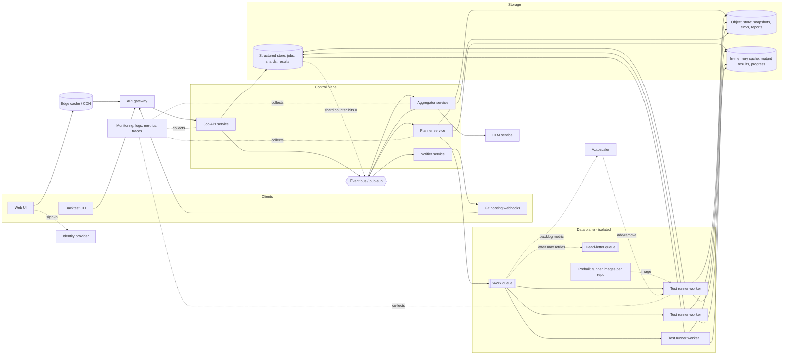

# Proofline — Design Document

> **Status:** v0.6. This is the design record, including history and plans. **What is actually built is described in [`ARCHITECTURE.md`](ARCHITECTURE.md)**; measured results are in [`evidence/README.md`](evidence/README.md). Section 17 is the original delivery plan.
> **Purpose:** the engineering source of truth for the build: requirements, the vendor-agnostic design, its AWS mapping, and the decision records behind it.

---

## 1. Summary

**Proofline** is a cloud-based verification service for code changes, aimed at the growing volume of AI-assisted pull requests. Instead of adding another opinionated reviewer, it produces **objective evidence** about how well a change is protected by its tests, and uses that evidence to **triage** pull requests: _"low risk, tests are strong"_ versus _"needs a senior reviewer: 7 of 9 injected faults in `auth/session.ts` went undetected"_.

Its assessment is defined by the **Proofline Verification Framework, PVF 1.0** ([`docs/framework.md`](docs/framework.md)). It's a versioned rule catalogue (test adequacy, reliability, security with CWE mappings, maintainability) with fixed assurance levels PV-1 to PV-4, per-path required levels, MISRA-style justified deviations, a reproducible witness for every finding, and SARIF output. Mutation testing provides the evidence for one of its rules, `PV-TEST-03`.

The long-term position is the **verification and trust layer for autonomous software engineering**: coding agents generate changes, and Proofline decides whether there is enough checkable evidence to trust each one. It integrates with agents through their pull requests rather than competing with them, and never edits the code it verifies. The roadmap, including which agent stages are deliberately rejected and why, is in [`future-development.md` §D](future-development.md#d-roadmap-proofline-as-the-trust-layer-for-autonomous-software-engineering).

The core technique is **mutation testing scoped to the changed lines**: Proofline injects small, deliberate faults (mutants) into the new code and re-runs the relevant tests. A surviving mutant is a concrete, reproducible fact rather than an opinion, which addresses the noise problem that causes developers to ignore AI review tools. An optional LLM stage generates adversarial property-based tests and reports **behavioural differences** between the base and head commits.

Mutation testing is embarrassingly parallel and expensive: one PR yields hundreds of independent test runs. This makes it a natural fit for **queue-driven, auto-scaling container workers**, **content-addressed result caching**, and an **event-driven fan-out / fan-in** workflow. These are the core cloud patterns the system is built on.

The system is evaluated by **backtesting** against the history of public JavaScript/TypeScript repositories: does a low Proofline score predict that a PR will later need a bug fix? The same backtest serves as the primary **load test**.

---

## 2. Problem Statement

1. **Code generation has outpaced code verification.** AI assistants make it cheap to produce large changes, while human review capacity is roughly fixed. Review becomes the bottleneck, and senior reviewers carry the load.
2. **Existing AI reviewers are noisy.** LLM review comments are opinions; a high false-positive rate trains developers to dismiss them. _(Industry figures on dismissal rates and PR size growth are mostly vendor-reported and should be treated with caution.)_
3. **Passing tests ≠ protected code.** A green CI run only shows that tests didn't fail. It says nothing about whether they would fail if the new code were wrong. Line coverage is a weak proxy: a line can be executed without its behaviour being asserted.
4. **Mutation testing answers the right question but is too slow to run locally** on every PR. It needs elastic, parallel compute, which makes it a cloud problem.

**Why the cloud?** Demand is bursty (PRs cluster around working hours and release days; a backtest submits hundreds of PRs at once), each unit of work is independent and parallelisable, and idle capacity should cost nothing. Elastic, pay-per-use compute is the only economical way to give fast answers at peak without paying for peak capacity all day.

---

## 3. Goals and Non-goals

### Goals
- **G1.** Given a PR (or two commits), compute a **changed-line mutation score** and a **risk tier** with an evidence list.
- **G2.** Return results for a typical PR (≤ 300 changed lines, test suite ≤ 2 min) within **10 minutes at p95**, including when many PRs are submitted at once.
- **G3.** **Scale to zero** when idle; scale out automatically under backlog.
- **G4.** Avoid repeat work: re-verifying an unchanged commit, or a commit where most files are unchanged, should reuse cached results.
- **G5.** Run untrusted repository code **safely isolated** from the platform and from other jobs.
- **G6.** Evaluate predictive value by **backtesting** on public repositories and report precision honestly.

### Non-goals
- Not a general AI code reviewer; Proofline does not comment on style or design.
- Not a CI replacement; it runs alongside CI.
- **JavaScript/TypeScript only**, tested with **Vitest**. Other runners (Jest) and languages are future work.
- The codebase is plain JavaScript (ESM) for now; migrating to TypeScript is future work.
- No private-repo or multi-tenant billing support in this iteration.
- PR decomposition (splitting large PRs) is out of scope; see [§16](#16-future-work).

---

## 4. Users and User Stories

| ID | As a… | I want to… | So that… |
|---|---|---|---|
| US1 | Developer | submit a PR URL or two commit SHAs and get a verification report | I know whether my tests actually protect my change |
| US2 | Reviewer / tech lead | see a risk tier on each PR in GitHub | I can spend senior review time where it matters |
| US3 | Developer | see exactly which injected faults survived, with line and diff | I can write the missing assertion quickly |
| US4 | Developer | re-run verification after pushing a fix and get a fast answer | iterating doesn't cost the full run again |
| US5 | Developer | watch progress while a job runs | I'm not left guessing on a long job |
| US6 | Researcher | backtest hundreds of historical PRs in one batch | I can measure whether the score predicts real bugs |
| US7 | Operator | see queue depth, worker count, cache hit rate and cost per PR on a dashboard | I can verify scaling and cost behaviour |
| US8 | Repo owner | install a GitHub App and have results posted as a PR check | verification happens without manual steps _(Tier 2)_ |
| US9 | Developer | optionally get LLM-generated adversarial tests and behavioural-difference findings | edge cases my tests missed are surfaced _(Tier 3)_ |

---

## 5. Requirements

### 5.1 Functional

| ID | Requirement | Tier |
|---|---|---|
| FR1 | Accept a job via web UI or REST API: a **registered** repository + base SHA + head SHA (or PR number). Arbitrary public repos are Tier 2 (they need on-demand environment builds; see D5). | MVP |
| FR2 | Snapshot the repository at both commits; compute the changed-line set. | MVP |
| FR3 | Run a baseline test run with per-test-file coverage; detect and quarantine flaky tests (run twice; differing results → flaky). | MVP |
| FR4 | Generate mutants **only on changed lines**, partition them into shards, and run only the test files that cover each mutated line. | MVP |
| FR5 | Look up each mutant in the result cache before executing it. | MVP |
| FR6 | Aggregate shard results into a report: mutation score, surviving mutants with diffs, changed-line coverage, static-analysis findings, risk tier. | MVP |
| FR7 | Expose job status and progress (polling); persist reports with a shareable URL. | MVP |
| FR8 | Batch-submit a list of historical PRs for backtesting. | MVP |
| FR9 | Expire repository snapshots and intermediate artefacts automatically. | MVP |
| FR10 | GitHub App: receive `pull_request` webhooks, post results as a Check Run. | Tier 2 |
| FR11 | Live progress over WebSocket. | Tier 2 |
| FR12 | **Verified test suggestions:** for each surviving mutant, an LLM proposes a test; it is reported only if it passes on head **and** kills that mutant (future-development D3). | Tier 3 |

### 5.2 Non-functional (measurable targets)

| ID | Quality | Target | How verified |
|---|---|---|---|
| NFR1 | Latency | p95 ≤ 10 min end-to-end for a typical PR at 50 concurrent users | Load test + CloudWatch |
| NFR2 | Scalability | Workers scale 0 → N under backlog; backlog drains in proportion to N | Backtest burst; scaling graph |
| NFR3 | Cost | ≈ $0 compute when idle; cost per PR reported | Pricing Calculator + Cost Explorer tags |
| NFR4 | Cache efficiency | ≥ 90 % mutant cache hit rate when re-verifying an unchanged commit | Dashboard metric |
| NFR5 | Security | Untrusted code has no network access and no platform credentials; least-privilege roles | Design review + negative tests |
| NFR6 | Reliability | No job is lost or double-counted under worker crashes or message redelivery | Fault-injection test (kill workers mid-job) |
| NFR7 | Observability | Every job traceable across services by `jobId`; dashboard for queue, workers, cache, errors | Trace + dashboard screenshots |
| NFR8 | Maintainability | Infrastructure defined in version-controlled code; one-command deploy and teardown | Deploy/teardown script (§11.1) |

---

## 6. Vendor-agnostic Architecture

### 6.1 Component diagram



> A rendered version, grouped by compute, storage, communication and identity, is [`report/figures/architecture-agnostic.png`](report/figures/architecture-agnostic.png).

### 6.2 Components

| Component | Responsibility | State |
|---|---|---|
| **Edge cache / CDN** | Serves the static web UI and immutable completed reports close to users | Cached copies only |
| **API gateway** | Single entry point; authentication, request validation, rate limiting, webhook signature verification | Stateless |
| **Job API** | Creates jobs, returns status/progress, serves reports | Stateless (state in stores) |
| **Planner** | Orchestration only; **never executes repository code** (D8). Phase 1: snapshot the repo, compute the diff, enqueue a *baseline* shard. Phase 2 (after the baseline result): parse changed files, generate mutants, select tests from the coverage map, check the cache, enqueue mutant shards | Stateless; event-triggered |
| **Runner images** | MVP: one prebuilt image per registered repo, with dependencies installed at image build time (D5). Tier 2: on-demand environment builder for arbitrary repos | Immutable images |
| **Work queue** | Buffers shards; decouples planning from execution; at-least-once delivery | Durable |
| **Test runner workers** | Pull shards (baseline or mutant), apply each mutant, run selected tests with timeouts, record results. The **only** place repository code is executed | Stateless; disposable |
| **Aggregator** | On job completion, computes score and risk tier, optionally runs the LLM stage, renders the report | Stateless |
| **Notifier** | Posts results back to the git host (check run) and pushes progress to clients | Stateless |
| **Structured store** | Jobs, shards, per-mutant results, completion counters, durable result cache | Durable |
| **Object store** | Repo snapshots, environment archives, logs, rendered reports; lifecycle expiry | Durable, expiring |
| **In-memory cache** | Hot mutant-result cache; live progress counters | Volatile (rebuildable) |
| **Event bus** | Decouples lifecycle events: `JobCreated`, `JobCompleted`, `ReportReady` | Transient |
| **Autoscaler** | Adjusts worker count from queue backlog per worker | Config only |
| **Identity provider** | User sign-in for the web UI; issues tokens validated at the gateway | Managed |
| **Monitoring** | Centralised logs, metrics, distributed traces, dashboards, alarms | Managed |

### 6.3 Pattern selection

| Required category | Pattern chosen | Why it fits Proofline | Alternative considered and rejected |
|---|---|---|---|
| Storage | **Structured** (jobs/results) + **unstructured** (snapshots, envs, reports) | Results are small, key-addressed and queried by job; artefacts are large blobs | Single relational DB: unnecessary joins and always-on cost |
| Caching | **In-memory** (hot results, single-flight locks); **edge** designed but not built | Mutant results are content-addressed and immutable, so they never need invalidation; reports never change once complete | Caching API responses only: misses the real expensive work |
| Communication | **Message queue** (shards), **pub-sub** (lifecycle events), **API gateway**, **polling** (progress), **request callback** (webhook in, check run out) | Queue absorbs bursts and gives retry semantics; pub-sub lets the notifier and aggregator evolve independently | Synchronous HTTP fan-out to workers: no buffering, lost work on crash |
| Compute | **Containers** (runners) + **serverless functions** (API, planner, aggregator, notifier) | Test runs need custom images, minutes of runtime and strong isolation; control-plane work is short and spiky | VMs: slower to scale, patching burden, idle cost |
| Scaling | **Metric-based**: backlog per worker | Directly measures unmet demand; CPU is misleading for I/O-heavy test runs | CPU-based scaling: lags behind queue growth |
| Load distribution | **Worker-pull** | Workers take work only when ready; natural back-pressure; no load balancer needed in the data plane | Dispatcher-push: requires tracking worker health and capacity |
| Additional | Event-driven architecture · microservices · identity & RBAC · fault tolerance & resilience patterns (retries, timeouts, DLQ, idempotency, circuit breaker) · garbage collection · monitoring incl. cost · public vs private access · stateless design · AI/ML services · infrastructure as code | | |

### 6.4 Key design decisions

- **D1 — Shard granularity.** One message per *batch* of ~10–20 mutants on the same file rather than one per mutant. Restoring the environment costs seconds; amortising it over a batch cuts overhead, while batches stay small enough to parallelise and to retry cheaply. *Trade-off:* coarser shards mean slower tail completion; tune batch size by measurement.
- **D2 — Content-addressed caching.** Cache key for a mutant result:
  `sha256(mutant_id ‖ dependency_fingerprint ‖ selected_test_ids ‖ env_hash)`.
  `mutant_id` covers the file, location, operator and replacement. `dependency_fingerprint` hashes the contents of the mutated file **and every file the selected tests executed in the baseline** (known from per-test-file coverage), plus test helpers and tooling config (`package.json`, `vitest.config.*`, `tsconfig.json`). Hashing only the mutated file and the test files would be wrong: a change to a helper module the tests call can change the outcome.
  Because the key captures every source input, a cached result is **never stale**, so no invalidation logic is needed. *Trade-offs:* flaky tests break this assumption (quarantined in the baseline step, FR3), and inputs outside source files (data files, environment variables) aren't captured (limitation). `env_hash` covers the lockfile and Node version.
- **D3 — Test selection by coverage.** Each mutant runs only the tests that executed its line in the baseline run, rather than the full suite. This is the same idea used in published mutation testing at scale (see [§15](#15-research-and-learning-plan)). *Trade-offs:* misses tests that would catch a mutant via an indirect path, which is accepted for a large speed-up. Selection is per **test file**, not per test: the baseline runs each test file on its own with V8 coverage. Coarser selection means some extra tests run per mutant; per-test selection would need per-test instrumentation (future work).
- **D4 — Idempotent fan-in with a set.** Each worker first writes its per-mutant results (idempotent puts keyed by `mutantId`), then adds its `shardId` to the job's `completedShards` set in **one atomic update that returns the new set**. Adding to a set is idempotent, so a redelivered message can't double-count. The worker that sees `size(completedShards) = shardsTotal` publishes `JobCompleted`. A redelivery can publish it twice, so the aggregator claims the job with a conditional status change (`RUNNING → AGGREGATING`) and ignores duplicates. Result: **effectively-once** completion on top of an at-least-once queue, with no streams or extra services. _(v0.1 used a transaction plus a decrementing counter, but DynamoDB transactions don't return updated values, so a worker couldn't tell it was the last one.)_
- **D5 — Prebuilt environments for the MVP.** Installing dependencies at job time needs internet access, runs untrusted install scripts, and building environments on demand is a project in itself. The MVP therefore supports a set of **registered repositories**, each with a runner image whose dependencies are installed when the image is built. An on-demand environment builder with its own minimal permissions is Tier 2. *Trade-off:* the MVP can't verify arbitrary repos, but the backtest only needs a handful of fixed repos.
- **D6 — Rule-based, explainable risk tier.** The tier is a transparent function of the evidence (score, changed-line coverage, PR size, sensitive paths, static findings), with weights calibrated by the backtest. An opaque ML model would be harder to trust and harder to explain to the people acting on it.
- **D7 — Differential validation for LLM tests (Tier 3).** A generated test is only reported if it **passes on the base commit and fails on the head commit**. Tests that fail on both are discarded as wrong. Findings are labelled *behavioural differences* (which may be intended), not *bugs*.
- **D8 — The baseline run is a shard, not a planner step.** The baseline (full test suite twice, with per-test coverage) is the only planning step that needs the full environment, can take minutes, and **executes untrusted code**. Running it as a special `BASELINE` shard on the runner fleet keeps all untrusted execution inside the sandbox, lets the planner stay a short serverless function, and makes baselines scale with everything else. *Trade-off:* planning becomes two phases connected by a `BaselineCompleted` event, with one extra job state. See [DR-2](#dr-2--planner-lambda-vs-fargate-run-task).
- **D9 — Own mutation engine.** Mutants are generated by a small, purpose-built engine on the Babel parser rather than by wrapping an existing tool, because changed-line scoping and stable, content-addressed mutant IDs are central to the design. See [DR-3](#dr-3--mutation-engine-own-engine-vs-strykerjs).

### 6.5 Scaling design

- **Metric:** queue depth `backlog = waiting + in-flight` shards. Counting in-flight shards stops the service shrinking under workers that are still busy. **v0.5:** it's read *live* (`GetQueueAttributes`) by a `backlog-publisher` Lambda every minute and published as the custom metric `Proofline/Backlog`. The first design used SQS's own CloudWatch metrics, and the 160-job load test showed why that fails: those arrive **3–4 minutes late**. The scale-to-zero alarm saw five stale minutes of zeros and **stopped the only worker with 159 shards waiting**; scale-out then took about 3.5 minutes to notice the backlog (`evidence/load-160.csv`, `evidence/scaling-load-160.txt`). Both alarms treat *missing* data as "do nothing", so a stopped publisher can't cause a scale-in.
- **Policy:** step scaling with **`ExactCapacity`**, so each backlog band maps straight to a worker count. Initial bands: 1–9 → 1, 10–39 → 3, 40–149 → 6, 150–399 → 12, ≥ 400 → 20, to be tuned against the latency target by load testing. A second alarm sets capacity to **0** after the backlog has been 0 for 5 minutes. Scaling from zero works natively, which a ratio metric can't do (DR-5).
- **Bounds:** min 0, max 20, to bound cost and respect account limits.
- **Reaction time:** SQS metrics arrive at one-minute granularity with some delay, and a Fargate task needs ~30–60 s to start, so expect 1–3 minutes from a burst to new capacity. Fine for minutes-long jobs; measured in the load test.
- **Re-evaluation:** Application Auto Scaling keeps applying a step policy "for additional alarm breaches until the alarm state returns to OK" (AWS step-scaling docs). So one alarm is enough for a growing backlog to keep moving into higher bands.
- **Scale-in safety:** `ExactCapacity` also *lowers* capacity. As a large backlog drains into a lower band, the policy would cut workers that are still mid-shard. Runners therefore hold **ECS task scale-in protection** while working (set through the ECS agent endpoint, refreshed with the visibility heartbeat, released after each shard), and ECS only stops a task once it's unprotected. If protection were unavailable, an interrupted shard would still reappear after its visibility timeout, and the idempotent writes (D4) make that cost time, not correctness.
- **Control plane:** serverless functions, which scale on their own and need no scaling policy.

### 6.6 Asynchronous workflow

Submission returns immediately with a `jobId` (`202 Accepted`). All heavy work happens asynchronously, driven by events and the queue. Clients learn about progress via **polling** (MVP) or **WebSocket** (Tier 2); git hosts learn via **callback** (check run).

### 6.7 Observability

- **Correlation:** `jobId` and `shardId` on every log line, message attribute and trace.
- **Metrics:** queue depth and age of oldest message, running workers, shard duration, mutants/min, cache hit rate, DLQ depth, job latency p50/p95, **cost per PR** (estimated from worker-seconds).
- **Tracing:** distributed traces from the API through the planner to the aggregator.
- **Alarms:** DLQ depth > 0; age of oldest message > threshold; error rate.

### 6.8 Limitations (initial)

- **Equivalent mutants** (changes that don't alter behaviour) count as survivors and deflate scores. Mitigation: operator selection and the option to suppress known equivalent patterns.
- Only JavaScript/TypeScript projects tested with Vitest; tests that need network or external services cannot run in the sandbox.
- Coverage-based test selection may under-report kills.
- Backtest labels (bug-fix commits) are a noisy proxy for "this PR was buggy".

---

## 7. Key Workflows

### 7.1 Verify a pull request

```mermaid
sequenceDiagram
  autonumber
  actor Dev as Developer / Git host
  participant GW as API gateway
  participant API as Job API
  participant BUS as Event bus
  participant PL as Planner
  participant C as In-memory cache (VPC)
  participant Q as Work queue
  participant W as Runner worker
  participant DB as Structured store
  participant AG as Aggregator
  participant N as Notifier

  Dev->>GW: POST /jobs {repo, baseSha, headSha}
  GW->>API: validated request
  API->>DB: put Job(status=QUEUED)
  API->>BUS: JobCreated
  API-->>Dev: 202 {jobId}
  BUS->>PL: JobCreated
  PL->>PL: snapshot repo to object store, compute diff
  PL->>Q: enqueue BASELINE shard
  Q->>W: baseline shard
  W->>W: run suite twice (flaky check), then each test file with coverage
  W->>BUS: BaselineCompleted {coverageMapKey}
  BUS->>PL: BaselineCompleted
  PL->>PL: parse changed files, generate mutants, select tests
  PL->>DB: batch-get CACHE# keys (durable result cache)
  DB-->>PL: hits / misses
  PL->>DB: store cached results, set shardsTotal
  PL->>Q: enqueue shards (misses only)
  loop each shard (parallel across workers)
    W->>Q: receive shard
    W->>W: restore env, apply mutant, run selected tests
    W->>C: check hot tier, take single-flight lock (runners only)
    W->>C: write result through (Valkey + CACHE# in DB)
    W->>DB: put results; ADD shardId to completedShards (returns set)
    W->>Q: delete message
  end
  W->>BUS: JobCompleted (worker that completed the set)
  BUS->>AG: JobCompleted
  AG->>AG: score, risk tier, render report
  AG->>BUS: ReportReady
  BUS->>N: ReportReady
  N->>Dev: Check run / UI notification
  Dev->>GW: GET /jobs/{jobId} (polling)
```

### 7.2 Re-verify after a small fix (cache path)
The planner generates mutants again, but only mutants in files whose content hash changed miss the cache. Everything else comes back as cache hits, and if every mutant hits, the job completes without touching the queue.

### 7.3 Backtest batch
The CLI reads a list of historical PRs and submits jobs at a controlled rate. Thousands of shards accumulate, workers scale out to the maximum, the backlog drains, and workers scale back to zero. This run produces both the **evaluation data** ([§14](#14-evaluation-backtest-plan)) and the **scaling evidence**.

### 7.4 Failure handling

| Failure | Detection | Handling |
|---|---|---|
| Worker crash mid-shard | Message not deleted | Reappears after visibility timeout; idempotent write (D4) prevents double counting |
| Shard fails repeatedly (poison message) | Receive count > max | Moved to DLQ; job marked `PARTIAL` with an explicit note; alarm fires |
| Test hangs / infinite loop from mutant | Per-test and per-shard timeouts | Mutant recorded as `TIMEOUT` (counted as killed, the standard convention) |
| Baseline tests fail | Baseline shard result | Job fails fast with `BASELINE_FAILED`; no mutant shards enqueued |
| Repo not registered / no runner image | Job API | Rejected with `REPO_NOT_REGISTERED` before any compute is spent |
| Duplicate `JobCompleted` event | Aggregator | Conditional status change `RUNNING → AGGREGATING`; duplicate ignored |
| In-memory cache unavailable | Connection error / timeout on the runner | Skip the hot tier and single-flight locks; read and write DynamoDB directly (slower, possibly duplicate work, still correct results) |
| LLM service slow or erroring | Timeout / error rate | Circuit breaker opens; report published without the LLM section and marked as such |
| Git host API rate-limited | 403/429 | Exponential backoff with jitter; notification retried from the event bus |
| Invalid input (bad URL, SHA, too-large diff) | API validation | `400` with reason; size caps enforced before any compute is spent |

---

## 8. Data Model

### 8.1 Structured store (single-table design)

| Entity | PK | SK | Key attributes |
|---|---|---|---|
| Job | `JOB#<jobId>` | `META` | repo, baseSha, headSha, status, createdAt, shardsTotal, completedShards (string set), score, riskTier, reportKey, ttl |
| Shard | `JOB#<jobId>` | `SHARD#<shardId>` | status, mutantIds, durationMs, workerId, attempts |
| Mutant result | `JOB#<jobId>` | `MUT#<mutantId>` | file, line, operator, outcome (`KILLED`/`SURVIVED`/`TIMEOUT`/`ERROR`), killingTest, cacheHit |
| Result cache | `CACHE#<cacheKey>` | `RESULT` | outcome, killingTest, ttl |
| Env | `ENV#<envHash>` | `META` | status, objectKey, builtAt |

Access patterns: get job + all shards/results by `PK`; cache lookups by key; jobs by user/repo via a secondary index (`GSI1PK = REPO#<repo>`, `GSI1SK = createdAt`).

### 8.2 Object store layout

```
snapshots/<jobId>/<sha>.tar.gz        expires after 1 day
coverage/<jobId>.json                 baseline coverage map; expires after 1 day
envs/<envHash>.tar.gz                 Tier 2 only; expires 14 days after last use
logs/<jobId>/<shardId>.log            expires after 7 days
reports/<jobId>.json | .html          kept (small); served via edge cache
```

### 8.3 Messages

**Shard message (work queue):**
```json
{
  "schemaVersion": 1,
  "jobId": "j_01JB8Z5Q3K",
  "shardId": "s_0007",
  "snapshotKey": "snapshots/j_01JB8Z5Q3K/9f2c1ab.tar.gz",
  "envHash": "e3b0c442...",
  "file": "src/router/match.ts",
  "mutants": [
    { "mutantId": "m_3f9a1c07d2e4b811", "line": 42, "start": 1180, "end": 1186,
      "operator": "ROR_LT_TO_LTE", "original": "i < n", "replacement": "((i) <= (n))",
      "cacheKey": "5d41402a..." },
    { "mutantId": "m_8c21e5aa90f3d417", "line": 45, "start": 1251, "end": 1263,
      "operator": "RVR_TO_UNDEFINED", "original": "params[name]", "replacement": "undefined",
      "cacheKey": "7215ee9c..." }
  ],
  "tests": ["test/match.test.ts", "test/router.test.ts"],
  "timeoutMs": 21000,
  "traceId": "1-6720a1b3-..."
}
```

**Lifecycle event (pub-sub):**
```json
{ "type": "JobCompleted", "schemaVersion": 1, "jobId": "j_01JB8Z5Q3K",
  "completedAt": "2026-11-02T03:14:07Z", "partial": false }
```

**Report (excerpt):**
```json
{
  "jobId": "j_01JB8Z5Q3K",
  "repo": "example-org/router", "baseSha": "1a2b3c4", "headSha": "9f2c1ab",
  "changedLines": 142, "changedLineCoverage": 0.87,
  "mutants": { "total": 96, "killed": 71, "survived": 19, "timeout": 6, "cacheHits": 0 },
  "mutationScore": 0.81,
  "riskTier": "MEDIUM",
  "evidence": [
    { "file": "src/router/match.ts", "line": 42, "operator": "ROR_LT_TO_LTE",
      "diff": "- if (i < n) {\n+ if (((i) <= (n))) {", "outcome": "SURVIVED" }
  ],
  "llm": { "status": "SKIPPED_CIRCUIT_OPEN" }
}
```

---

## 9. Caching Design

| Layer | Where it's read | What | Key | Expiry | Why |
|---|---|---|---|---|---|
| **Edge** (CDN) _(designed, not built)_ | Browsers | Web UI assets; completed reports | URL (report URL includes `jobId`) | Long TTL; reports are immutable once complete; UI uses hashed filenames | Reports are read many times and never change |
| **Durable result cache** (structured store) | Planner and runners | Mutant outcomes | `CACHE#<contentKey>` (D2) | TTL 30 days | Content-addressed and reachable from outside the VPC, so the planner skips the queue for every hit. A fully cached job completes during planning |
| **In-memory** (Valkey) | Runners only | (1) hot read-through copy of outcomes; (2) single-flight locks `lock:<contentKey>` | Same content key | Outcomes 6 h; locks expire after the mutant's timeout | Runners look up hundreds of keys per shard, and locks need precise expiry, which DynamoDB TTL (deleted lazily, up to days later) can't give |
| **Runner images** | ECS | Per-repo images with dependencies installed | Image tag = `hash(lockfile, Node version)` | Old tags removed by registry lifecycle policy | Dependency install is often the slowest step, so it never happens at job time |

**Read path:**
1. The planner batch-reads `CACHE#` keys from DynamoDB, records hits immediately, and enqueues only the misses.
2. For each mutant, a runner checks Valkey, then DynamoDB.
3. Still a miss: the runner takes the single-flight lock. If another runner already holds it (the same mutant in a concurrent job, common in backtests), it waits briefly for that result instead of running the mutant again.
4. After executing, it writes the result through to both tiers.

Because keys are content hashes, there is no invalidation problem. The trade-off is correctness under non-determinism, which is handled by flaky-test quarantine.

---

## 10. Security Design

- **Isolation boundary.** Each runner is a separate container task. Untrusted test code runs as an unprivileged user, separate from the worker agent, with CPU, memory and time limits and a read-only base filesystem.
- **No network for untrusted code.** Runners sit in a private network segment with **no internet route**; they reach only the object store, queue, structured store and log service through private endpoints. Only the environment builder (Tier 2) has outbound access, limited to HTTPS.
  _Fallback for restricted accounts:_ if VPC endpoints or custom subnets can't be created, use the account's existing private subnets, a security group with minimal egress, and a preloaded Node module (`NODE_OPTIONS=--import …`) that blocks `net`, `http` and `fetch` inside test processes. This is a much weaker guarantee and must be reported as a limitation.
- **Credential exposure.** Platform credentials are available inside the task. Mitigations: run untrusted code as a different OS user that cannot read the agent's environment, don't pass credential variables to the child process, and scope the runner role to *receive/delete on one queue, read one snapshot prefix, write one results table*. If the account only provides shared, pre-made roles, document this policy as the intended design and state the gap. Credential exposure is a known limitation; the stronger fix is a separate micro-VM or a user-space kernel sandbox per test run (future work).
- **Identity & RBAC.** Web users authenticate with the identity provider; the gateway validates tokens. Webhooks are authenticated by **HMAC signature** verification. Git host app credentials are kept in a secrets manager and exchanged for short-lived, installation-scoped tokens.
- **Public vs private.** Public: CDN, gateway. Private: everything else. Reports are reachable only by unguessable ID (MVP); per-user access control in Tier 2.
- **Input limits.** Caps on repo size, changed lines, mutant count and test runtime protect against abuse and runaway cost.
- **Data retention.** Snapshots expire after 1 day (garbage collection); no source code is kept beyond the configured retention period.

---

## 11. Vendor-specific Implementation (AWS)

The reference deployment runs in a **locked-down, shared AWS account**: an AWS Control Tower landing zone with pre-provisioned IAM roles and networking, and explicit deny policies on IAM, networking, tagging and some logging actions. The design is deliberately shaped to work within those limits; §11.1 and §11.2 record how. Names, tags, roles and network lookups are configuration (`infra/config.js`), so the same scripts deploy into a less restricted account unchanged.

| Vendor-agnostic component | AWS service | Notes / decisions |
|---|---|---|
| Edge cache / CDN | **CloudFront** _(not built: the web UI was set aside)_ | S3 origin for UI and reports |
| Static web UI | **S3** | React SPA |
| API gateway | **API Gateway** HTTP API (WebSocket in Tier 2) | Routes under a configurable prefix (default `/v1`) on an existing HTTP API |
| Identity provider | **Cognito**, an existing user pool | JWT authorizer on the job routes |
| Job API, Planner, Aggregator, Notifier | **Lambda** | Planner never runs repo code (D8, DR-2) |
| Test runner workers | **ECS Fargate service** in private subnets, no public IP | Runs baseline and mutant shards; needs no inbound traffic (worker-pull) |
| Autoscaler | **Application Auto Scaling** (ECS service scaling) + CloudWatch alarms | **Step scaling with `ExactCapacity`** on live queue depth (visible + in-flight), plus a scale-to-zero alarm (DR-5) |
| Work queue + DLQ | **SQS** standard queue + DLQ | Visibility timeout > max shard time; `maxReceiveCount` = 3 |
| Event bus | **EventBridge** (custom bus) | Rules route `JobCreated`, `BaselineCompleted`, `JobCompleted`, `ReportReady` to Lambda targets (DR-1) |
| Structured store | **DynamoDB** single table, TTL | Keys derived from access patterns (§8.1) |
| Object store | **S3** + lifecycle rules | Garbage collection by prefix |
| In-memory cache | **ElastiCache for Valkey**, `cache.t4g.micro`, port 3001, TLS + auth token (from Secrets Manager), existing private cache subnet group | **Runners only** (Lambdas can't join the VPC): hot result tier and single-flight locks (DR-4). Valkey rather than Memcached because locks need `SET NX PX` |
| Durable result cache | **DynamoDB** (`CACHE#<key>` items in the main table, TTL 30 days) | Reachable from the planner Lambda, so cache hits never reach the queue (DR-4) |
| Container registry | **ECR** | One runner image per registered repo |
| Secrets | **Secrets Manager** / Parameter Store | Valkey auth token; GitHub App key and webhook secret (Tier 2) |
| Network isolation | Existing VPC: private subnets with NAT egress and an S3 gateway endpoint; one shared security group | Runner egress can't be removed at the network layer, so test processes get a network-blocking preload module (§10). Stated as a limitation |
| IAM | **Pre-existing roles only**: the account doesn't permit role creation. Four roles: Lambda, ECS task, ECS task execution, EventBridge scheduler | Least-privilege policies documented as intended design; the gap is stated as a limitation |
| LLM service | **Bedrock**: `nvidia.nemotron-super-3-120b` (text and tool calling) for adversarial test generation; `google.gemma-3-12b-it` as a fallback | Tier 3 only. The account's model catalogue is restricted to a few models |
| Monitoring | **CloudWatch** alarms on published metrics; Lambda logs. X-Ray isn't available in the account | **ECS containers can't log to CloudWatch** in this account, so runners write shard logs to S3 and outcomes to DynamoDB, and job-level metrics come from Lambda |
| Infrastructure as code | **Scripted deploy** (Node.js + AWS SDK for JavaScript v3), idempotent create-or-update with matching teardown. CDK ruled out: IAM role creation isn't permitted | Every resource is named `<prefix>-<component>` and tagged on creation |

### 11.1 Simplifications for a restricted account

These parts of v0.1 were more than the target account (or a small team) could support:

| v0.1 design | Why it's a problem | Simplified version (v0.2) |
|---|---|---|
| AWS CDK for everything | `cdk bootstrap` creates IAM roles, an S3 bucket and an ECR repo, and CDK auto-creates an IAM role for every Lambda and task. Locked-down accounts commonly block IAM role creation | **Decided:** one idempotent `deploy` + `teardown` script (Node.js, AWS SDK v3) using the existing roles. Still infrastructure as code, just without a framework |
| Runners with no network via VPC endpoints | Creating endpoints/subnets is likely blocked; interface endpoints also cost money around the clock | Existing private subnets + a network-blocking preload module; stated as a limitation |
| Least-privilege IAM role per component | Roles can't be created | Use the existing roles; document the intended policies as design |
| On-demand environment builder | A second untrusted-code path, internet egress, and a large build | Prebuilt runner image per registered repo (D5) |
| Planner running the baseline | Untrusted code in the control plane; Lambda time limits | Baseline as a runner shard (D8) |
| Fan-in via DynamoDB transaction | Transactions don't return the new counter value | Atomic set-add that returns the set (D4) |
| Two-tier result cache | Extra code paths for little MVP benefit | In-memory cache only; durable tier optional |
| Redis-specific features | The account might only offer Memcached | **Resolved:** Valkey was available and is used, because single-flight locks need `SET NX PX`; Memcached was rejected |
| X-Ray tracing | Unavailable; extra setup | `jobId` in structured JSON logs + CloudWatch Logs Insights |
| Fargate Spot | Needs capacity-provider changes on a shared cluster | On-demand Fargate; Spot remains a cost option |

Even after these cuts the design covers the full set of patterns it set out to use: structured + unstructured storage, in-memory + edge caching, API gateway + queue + pub-sub + polling, containers + serverless, metric-based scaling, worker-pull, event-driven architecture, identity/RBAC, resilience patterns, garbage collection and monitoring.

### 11.2 Account constraints (verified by probes)

Each constraint was confirmed with `infra/probe.js` (the deploying identity) or `infra/role-probe.js` (the Lambda and ECS roles) before the design relied on it.

| Constraint | Consequence for Proofline |
|---|---|
| Only pre-existing IAM roles can be used, and the Lambda role is denied some actions | **Probe every action before relying on it**: `events:PutEvents`, `sqs:SendMessage`, `cloudwatch:PutMetricData`, `ecs:DescribeServices`, ElastiCache access |
| ECS tasks can't send logs to CloudWatch: the execution role can't create log streams, and a task definition with `logConfiguration` makes every task die at startup | Runner logs go to S3 (`logs/<jobId>/<shardId>.log`), outcomes to DynamoDB; metrics come from Lambda and the runners' `PutMetricData` calls |
| `RegisterTaskDefinition` succeeds only with tags inline (a policy on `aws:RequestTag`) | The deploy script tags **on create** for every resource |
| S3 `put-bucket-tagging` fails under attribute-based access control; S3 Control `TagResource` works | Buckets are tagged through S3 Control |
| DynamoDB tables without the required tags at creation can't be read or written | Tag-on-create is mandatory for the table, not just good practice |
| The Node 22 Lambda runtime bundles the AWS SDK v3 clients | Lambda zips contain first-party code plus `@babel/parser` (planner) only |
| SNS, X-Ray, Step Functions and CloudFormation aren't available | None of them is used; EventBridge, structured logs and scripted deploys cover the same needs |
| An account policy stops EC2 instances and sets Auto Scaling groups to zero overnight | Fargate isn't affected. If the EC2 Auto Scaling group fallback is ever used, its bounds must be restored before use |
| Bedrock offers a small fixed set of models | Tier 3 uses Nemotron 3 Super for test generation |
| Private subnets route `0.0.0.0/0` through managed NAT gateways and have an S3 gateway endpoint | Runners run in **private subnets with no public IP**; S3 traffic stays on the endpoint. They still have outbound internet, so the sandbox limitation stands |
| Creating security groups is denied; the shared security group admits 80, 443, 3000–3010, 5000, 5432, 8080 and 11434 from anywhere, but not 6379/11211 | ElastiCache runs on a **custom port inside 3000–3010**, in the existing private cache subnet group, with TLS and an auth token, because the security group restricts nothing |
| The ECS task role may send to SQS, write DynamoDB and S3, put EventBridge events, publish CloudWatch metrics, read Secrets Manager and describe ECS services, from a private subnet | Runners can do all their work as designed. Because they can publish metrics, target tracking on backlog per task is possible |
| An explicit deny policy blocks Lambda `GetFunction`/`DeleteFunction` on a function that isn't (yet) tagged | Scripts create first, with tags, and never check for existence first |
| `logs:PutRetentionPolicy` is denied; creating a tagged log group is allowed | Lambda log groups are pre-created so they carry the tags (Lambda would otherwise create them untagged), but retention can't be set, so logs are kept indefinitely. Log volume is small |
| `ssm:PutParameter` with `Overwrite` is denied, so Parameter Store values are write-once | Parameter Store holds only names that never change (table, bucket, queue URLs, bus). The current runner image comes from ECR itself: phase 3 deploys the newest push |
| The same deny policy refuses S3 bucket settings (encryption) until the bucket is tagged, and sometimes refuses `sqs:TagQueue` on an existing queue | Tag immediately after creation (S3 Control for buckets), and treat re-tagging as best-effort. `infra/audit-tags.js` verifies every resource carries the tags |
| The Lambda role may use SQS, DynamoDB, S3, EventBridge, CloudWatch metrics, Secrets Manager and Parameter Store, and reach the internet, from outside a VPC | Planner, API, aggregator and notifier Lambdas work as designed, outside the VPC |
| Lambda **VPC attachment fails**: the role can't call `ec2:CreateNetworkInterface` | **No Lambda can reach ElastiCache.** The planner's cache lookups move to DynamoDB, and ElastiCache serves the runners only (DR-4) |
| The Lambda role is denied `ecs:DescribeServices` | A scheduled Lambda can't compute backlog per running task, so scaling uses queue depth directly (DR-5) |

---

## 12. Cost Model (to be validated)

Cost is dominated by **runner compute**, which scales with work done, not with time:

```
cost_per_PR ≈ (mutants_executed / mutants_per_shard) × shard_duration × (vCPU_price × vCPU + GB_price × GB)
mutants_executed = mutants_total × (1 − cache_hit_rate)
```

| Item | Behaviour | Idle cost |
|---|---|---|
| Fargate runners | Per-second, scale to zero | $0 |
| Lambda, API Gateway, SQS, SNS/EventBridge | Pay per request | ~$0 |
| DynamoDB on-demand, S3 | Pay per request + storage | Cents |
| ElastiCache | **Always-on**, the main fixed cost | Node-hours |
| VPC interface endpoints (only if permitted) | **Always-on**, per endpoint per AZ | Endpoint-hours |
| Bedrock | Per token, Tier 3 only | $0 |

**50 concurrent users:** measure a 15-minute session (PRs submitted, mutants per PR, shard duration, cache hit rate), extrapolate to monthly usage, and enter it into the AWS Pricing Calculator for a per-service total. The always-on items (ElastiCache, endpoints) are the main cost trade-off against security and latency.

**Sustainability:** scale-to-zero, Spot capacity (uses spare capacity), ARM/Graviton images where compatible, test selection and caching (avoid repeating compute), lifecycle expiry (no orphaned storage).

---

## 13. Testing Strategy

- **Unit:** diff → changed-line mapping; mutant generation; cache-key derivation; score/tier function.
- **Integration:** end-to-end on a small fixture repo with known surviving mutants (expected report checked into the repo).
- **Fault injection:** kill workers mid-shard; send duplicate messages; make the cache unavailable; force the LLM stage to time out. Expected: correct, non-duplicated results; DLQ and alarms behave as designed.
- **Load:** backtest burst ([§7.3](#73-backtest-batch)), plus concurrent API users with k6 or Locust to test the control plane.
- **Security negative tests:** a fixture repo whose tests try outbound HTTP, read the agent's environment, or fork-bomb. Expected: all blocked or contained.

---

## 14. Evaluation (Backtest) Plan

**Hypothesis H1:** PRs that Proofline rates `HIGH` risk are more likely than `LOW`-risk PRs to have their changed lines modified by a later bug-fix commit.

1. **Repos:** 3–5 actively maintained JavaScript/TypeScript projects whose **Vitest** suites run in ≤ 2 minutes without network access. Candidates to check (confirm each one uses Vitest): small `unjs` libraries such as `ufo`, `defu` and `pathe`, plus `zod`.
2. **Sample:** ~100–200 merged PRs per repo that touch source files.
3. **Labels:** identify bug-fix commits (linked issues labelled *bug*, or fix keywords), then trace the lines they change back to the PR that introduced them, using the **SZZ** approach from software engineering research. A PR is *bug-linked* if a fix touches its lines within N days.
4. **Metrics:** bug-linked rate per risk tier; relative risk HIGH vs LOW; precision and recall of `HIGH` as a predictor; correlation between mutation score and bug-linkage; and, for comparison, the same analysis using plain line coverage (does mutation score beat coverage?).
5. **Threats to validity:** SZZ label noise; survivorship bias (unfixed bugs); repo selection; equivalent mutants. Report all of these honestly, including a null result if that is what the data shows.

---

## 15. Research and Learning Plan

Topics researched to inform the design:

| Topic | Source to study | Expected design impact |
|---|---|---|
| Mutation testing at scale | Google, *Practical Mutation Testing at Scale* (Petrović et al.); Meta publications on mutation-guided LLM test generation | Changed-lines-only scoping, operator selection, surfacing only useful mutants |
| Bug-introducing-commit detection | SZZ algorithm literature | Backtest label design |
| Queue-backlog autoscaling | AWS docs on scaling on SQS backlog per instance; Application Auto Scaling target tracking | Scaling metric and 0→1 policy |
| DynamoDB single-table design and transactions | AWS DynamoDB docs | Fan-in counter, idempotent writes |
| Container sandboxing | Fargate isolation model; gVisor / Firecracker docs | Isolation boundary and stated limitations |
| AWS Well-Architected Framework | Six pillars + Serverless Lens | Structured review of the final design |
| AWS CDK | CDK developer guide | Infrastructure as code, tagging, teardown |

---

## 16. Future Work

The full list of dropped and deferred ideas, with reasons and what it would take to bring each back, is in [`future-development.md`](future-development.md). Headlines:

- PR decomposition: split large changes into ordered, independently reviewable pieces.
- Multi-language support (JavaScript with Stryker, Java with PIT).
- Stronger per-run sandboxing (micro-VM per test run).
- Learned risk model, once there's enough labelled data.
- Equivalent-mutant detection using an LLM or compiler-level analysis.

---

## 17. Delivery Plan

_The original plan, kept for the record; the build order actually followed is in the git history._

Week numbers are relative to project start.

| Week | Milestone | Exit criteria |
|---|---|---|
| 1 | Account checks + skeleton | Account permissions confirmed (§11.2); scripted deploy skeleton; tagged S3, DynamoDB, SQS deployed; mutation engine works locally on one fixture repo and is cross-checked against StrykerJS (DR-3). **Engine done** (`engine/`); StrykerJS cross-check pending |
| 2 | Walking skeleton | API → planner → queue → 1 Fargate worker → aggregator → report JSON, end to end |
| 3 | Scaling + caching | Backlog autoscaling 0→N→0 demonstrated; in-memory + durable result cache; env cache |
| 4 | Hardening + UI | DLQ, idempotent fan-in, timeouts, fault-injection tests pass; minimal web UI with progress polling; CloudFront |
| 5 | Backtest + evidence | Backtest run complete; dashboard and scaling graphs captured; Pricing Calculator estimate |
| 6 | Documentation | Architecture, evidence and user documentation written |
| Stretch | Tier 2 / Tier 3 | GitHub App + check runs; WebSocket progress; Bedrock verified test suggestions (future-development D3) |

**Rule:** don't start a Tier 2/3 feature until the MVP works end to end.

---

## 18. Risks and Open Questions

| Risk / question | Impact | Mitigation |
|---|---|---|
| Target account blocks VPC endpoints / subnet changes | Weaker sandbox network isolation | Fall back to restrictive security group egress; document as a limitation |
| Dependency environments too slow or large to restore per shard | Latency, cost | Env cache; larger shards; pre-baked images for backtest repos |
| Backtest shows no predictive signal | Weaker product claim | Still a valid, honest result; compare with coverage; discuss why |
| ElastiCache always-on cost | Fixed monthly cost | Smallest node; compare with serverless; justify against latency |
| Scope creep (Tier 2/3) | Unfinished MVP | Strict tier gating (§17) |
| Planner exceeds Lambda limits | Re-architecture | Resolved by D8: the planner never runs tests |
| IAM role creation blocked (confirmed) | No CDK; no per-component roles | Scripted deploy with existing roles (§11.1); least-privilege gap documented |
| Own mutation engine has bugs | Wrong scores | Fixture repo with known mutants (done); cross-check against StrykerJS (DR-3) |

**Open questions**
1. ~~SNS vs EventBridge~~ → **EventBridge** (DR-1).
2. ~~Planner on Lambda or Fargate~~ → **Lambda, with the baseline run moved to the runners** (DR-2, proposed).
3. ~~Own engine or an existing tool~~ → **own Babel-based engine, built**, to be cross-checked against StrykerJS (DR-3).
4. Which backtest repos run cleanly offline?
5. ~~Which services and permissions does the target account allow?~~ → probed and recorded (§11.2).

---

## 19. Decision Records

### DR-1 — Event bus: EventBridge (decided)

| | EventBridge | SNS |
|---|---|---|
| Routing | Rules match on any field of the event JSON (`detail-type`, `detail.partial`, …) | Subscription filter policies on message attributes or body |
| Targets | Lambda, SQS, Step Functions, ECS RunTask, API destinations, … | Lambda, SQS, HTTP, email, SMS |
| Replay | Archive and replay exist, but **not used**: archives can't be tagged, and every resource must carry the required tags | None built in |
| Event shape | Standard envelope (`source`, `detail-type`, `detail`) that serves as a documented contract | Free-form message |
| Latency | Typically sub-second; fine for lifecycle events | Slightly lower |
| Fit | Several event *types* with different consumers, the main case here | Simple one-topic fan-out |

**Why:** Proofline has four event types with different consumers, so content-based routing and a standard envelope keep the services decoupled. (Replay would help when debugging fan-in, but an archive can't carry the required tags, so it isn't used.) **Fallback:** if the Lambda role turns out to be denied `events:PutEvents`, each producer sends straight to a per-consumer SQS queue. SNS isn't available in the account, so it can't be the fallback. This loses content-based routing and replay but keeps the consumers unchanged.

### DR-2 — Planner: Lambda vs Fargate run-task (proposed: Lambda + D8)

What the planner must do: fetch the repo snapshot, compute the diff, run the **baseline** (full suite with coverage), generate mutants, select tests, query the cache, enqueue shards.

| Criterion | Lambda | Fargate run-task |
|---|---|---|
| Start-up | Milliseconds warm, ~1 s cold | Typically 30–60 s+ (provisioning + image pull) |
| Time limit | 15 min max | None |
| Tooling | Node.js runtime; no `git` unless you use a container image; `/tmp` configurable up to 10 GB | Any tool in the image (git, the repo's dependencies) |
| Runs the baseline? | Would need the repo's full environment inside Lambda, and would run **untrusted code next to control-plane permissions** | Can reuse the runner image, but still runs untrusted code with planner permissions unless separated |
| Idle cost | $0 | $0 (per-second, no service) |
| Triggering | Direct EventBridge target | EventBridge → ECS RunTask with input via container overrides; more wiring |
| Observability / local testing | Simple; logs per invocation | Per-task logs; slower dev loop |

**Key insight:** the only reason to consider Fargate is the baseline run: long, needs the full environment, and executes untrusted code. Moving the baseline onto the runner fleet as a `BASELINE` shard (D8) removes all three problems at once. The remaining planner work (download a tarball over HTTPS, parse with Babel, compute the diff, batch cache lookups, `SendMessageBatch`) takes seconds and needs no special tools, which suits Lambda.

**Costs of this choice:** two-phase planning (`PLANNING → BASELINE → RUNNING → AGGREGATING → DONE`), one more event type, and a coverage map passed via S3. **Revisit if:** snapshots of very large repos don't fit Lambda's `/tmp` or memory.

### DR-3 — Mutation engine: own engine vs StrykerJS (decided: own engine, built)

| Criterion | Own engine (Babel parser) | StrykerJS |
|---|---|---|
| Changed-line scoping | Native: only nodes that start on changed lines | Mutates configured files/globs; line ranges in `mutate` patterns are supported (verify in its docs), but results belong to Stryker's own run |
| Stable IDs for caching (D2) | `hash(file, span, operator, replacement)`, identical across runs and machines | IDs are per run; its incremental mode reuses results via a local JSON file, which isn't a content-addressed cache shared by a fleet |
| Distributed sharding | Designed for it: the planner emits mutant descriptors, workers apply them | Runs as one process that manages its own worker pool and test-runner plugin; fitting it to SQS shards means working around it |
| Operator breadth | 7 operator families, chosen deliberately | Broad, mature set (strings, arrays, regex, optional chaining, …) |
| Speed per mutant | One Vitest process per mutant (~1–2 s start-up) | **Mutant switching**: the code is instrumented once with every mutant and each is activated by ID, so there's no re-transform per mutant. Much faster |
| Test selection | Per test file (V8 coverage per file run) | Per test, via its Vitest runner plugin |
| Correctness risk | Own code, so own bugs; covered by unit and end-to-end tests | Battle-tested |
| Dependency risk | Only `@babel/parser` | Stryker core and runner-plugin versions must match the repo's Vitest version |

**Decision:** own engine, because change scoping, stable IDs and shard-friendly execution are the core of the cloud design, and none of them fit a tool built to run as one local process. StrykerJS's mutant-switching technique is the planned route to faster execution (future-development C7).

**As built** (`engine/src/mutate.js`):
- **Operators:** relational (`<`↔`<=`, `>`↔`>=`, `===`↔`!==`, `==`↔`!=`), arithmetic (`+`↔`-`, `*`↔`/`, `%`/`**`→`*`), logical (`&&`↔`||`), drop `!`, boolean and number literals, `return x`→`return undefined`, and deleting call / compound-assignment statements. Strings and template literals are skipped on purpose, since most of their mutants are equivalent and would add noise.
- **Splice, don't regenerate:** Babel's `start`/`end` offsets identify the exact span to replace, so the rest of the file is untouched and the report diff is one clean line. Operands and the whole replacement are parenthesised so operator precedence never changes.
- **ASI guard:** a replacement starting with `(` at the start of a statement gets a leading `;`, otherwise `f` followed by a new line starting `(x) <= (y)` would parse as a call on the previous line. Covered by a regression test.
- **TypeScript:** type-only nodes (interfaces, type aliases, annotations) are skipped; runtime wrappers such as `as`, `satisfies` and `!` are walked into.
- **Validation:** every mutant is re-parsed before use. Still to do: run StrykerJS on the fixture and one backtest repo and compare kill rates. Agreement is evidence of correctness; any disagreement points to an engine bug or a deliberate operator difference.

### DR-4 — Where the result cache lives (decided after the role probe)

**Constraint discovered:** the Lambda role can't create network interfaces, so **no Lambda can join the VPC**, and ElastiCache exists only inside the VPC. The original design, where the planner Lambda checks ElastiCache, is impossible in this account.

| Option | For | Against |
|---|---|---|
| A. Planner Lambda in the VPC, checks ElastiCache | Original design | **Impossible** (probe) |
| B. Planner on Fargate instead, inside the VPC | Can reach ElastiCache | Undoes DR-2 (start-up latency per job, more wiring) only to reach a cache |
| C. Runners check ElastiCache; planner checks nothing | Simple | Every cache hit still costs a queue message and a runner slot; a fully cached job can't finish at planning time |
| **D. DynamoDB as the durable cache the planner reads; Valkey as the runners' hot tier + single-flight locks** | Keeps the fast path (hits never reach the queue); each tier is reachable by the component that reads it | Two tiers to keep consistent; DynamoDB read cost per lookup |
| E. Drop ElastiCache; CDN + DynamoDB only | Cheapest, no always-on resource | Loses the in-memory pattern and the single-flight locks; edge caching alone would cover only the UI and reports |

**Decision: D.** Writes are write-through to both tiers, and both are keyed by the same content hash, so they can't disagree about a value. They can only differ in whether they hold it.

**Trade-off:** at low volume DynamoDB alone would be cheaper, since Valkey is the only always-on resource. Valkey earns its place under load:
- **Single-flight locks need `SET NX PX`** with precise expiry; DynamoDB TTL deletes lazily.
- **Hot lookups:** hundreds of lookups per shard at sub-millisecond latency.
- **Fewer DynamoDB reads:** the hot tier absorbs repeated reads during backtests, where many PRs share mutants.

The cost model (§12) should show the crossover point.

### DR-5 — Scaling policy (decided after the role probe)

| Option | For | Against |
|---|---|---|
| Target tracking on backlog per task (AWS's documented pattern for queue workers) | Smooth, self-tuning | Needs the running task count; the Lambda role is denied `ecs:DescribeServices`, and the ratio can't scale from zero |
| Target tracking on runner CPU | Built-in ECS metric, no custom code | CPU lags the queue, and a service at zero tasks has no CPU to measure |
| **Step scaling with `ExactCapacity` on queue depth (visible + in-flight)** | Uses only queue-published metrics; scales from and to zero; simple to explain and to test band by band | Bands are hand-tuned; less smooth than target tracking |

**Decision: step scaling on queue depth** (§6.5), with queue depth read live and published by a scheduled Lambda (v0.5, after the first load test showed SQS's metrics are too late to scale on). Target tracking stays a documented alternative: runners could publish a heartbeat metric to count themselves (the task role may call `PutMetricData`), which would make backlog per task computable. That's left as future work, because a scale-from-zero rule would still be needed alongside it.
