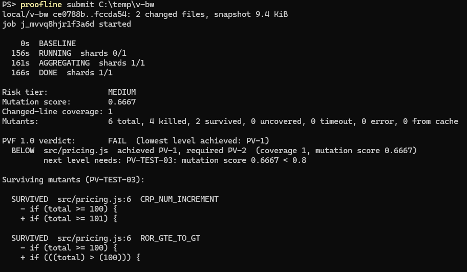
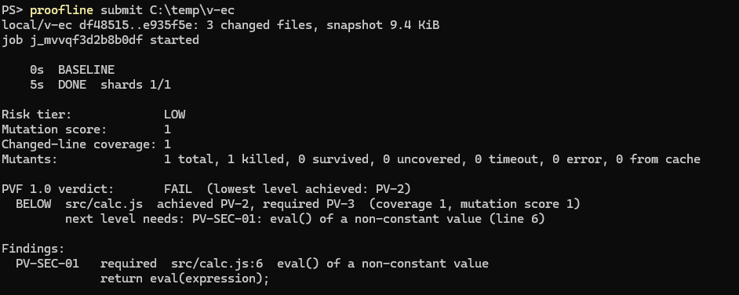
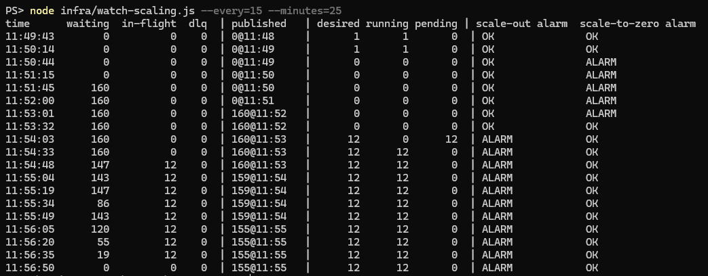
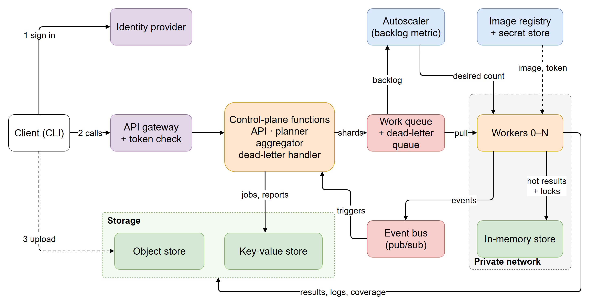
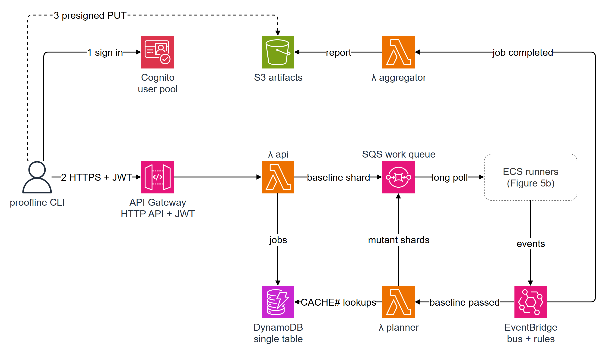
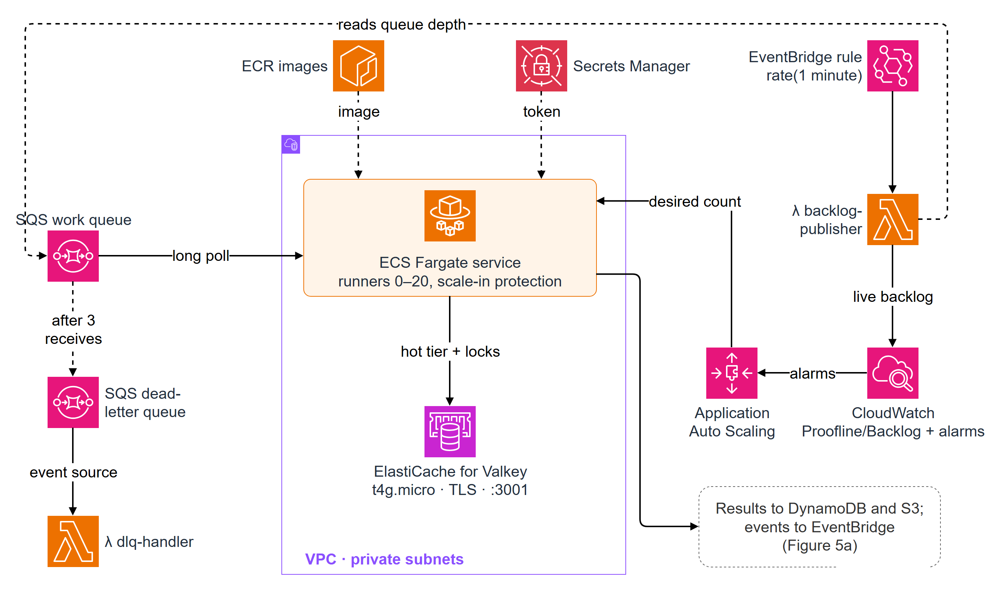
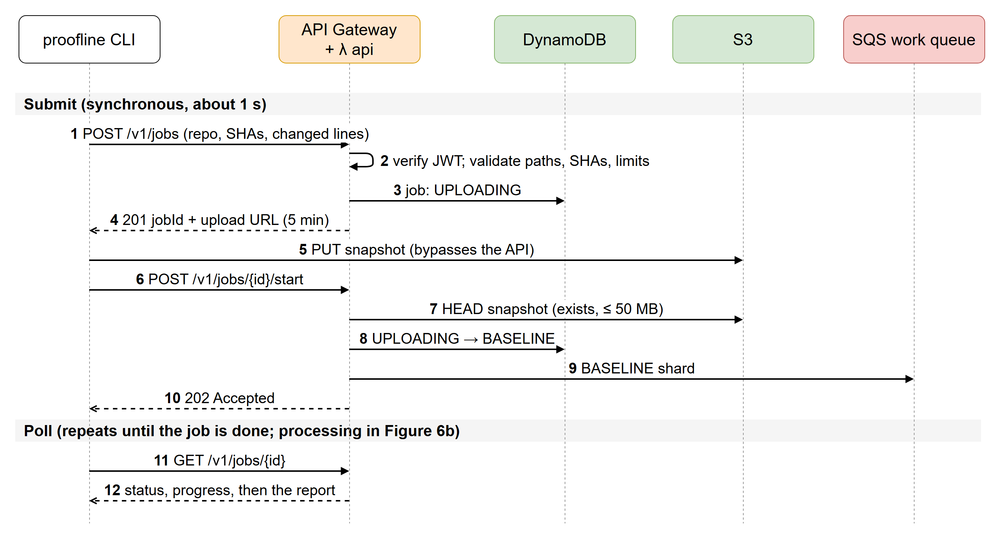
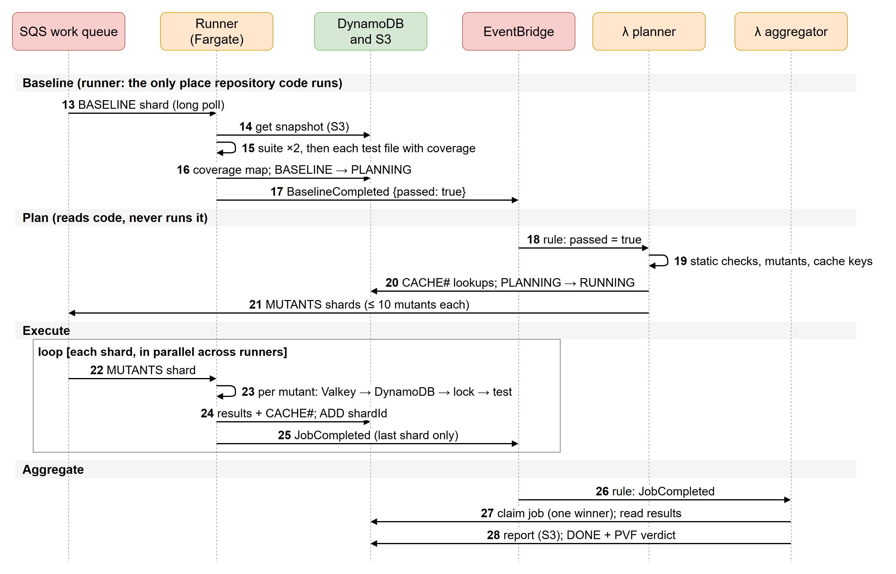

# Proofline: cloud verification of code changes

**Technical report** · design, implementation, evaluation and cost of the Proofline reference deployment on AWS.

---

## Summary

AI assistants have made code cheap to write, so the hard part is now deciding whether a change can be trusted. A green test run only shows the tests didn't fail, not that they would fail if the code were wrong.

Proofline checks this. A developer submits a commit range from a CLI. Proofline injects small faults (mutants) into the changed lines only, re-runs the tests that cover each one, checks the change against static rules, and gives one verdict against the Proofline Verification Framework (PVF 1.0). PVF has assurance levels PV-1 to PV-4, MISRA-style rule categories and deviations, security rules mapped to CWE, and SARIF output. The ideas come from existing practice: Google runs change-scoped mutation testing in code review, and SonarQube gates new code on fixed thresholds. Proofline's contribution is running them together as a cloud service, and measuring that service.

The workload is bursty, highly parallel (one change becomes hundreds of independent test runs) and should cost nothing when idle, so it suits the cloud. On AWS, Lambda functions behind API Gateway form the control plane; ECS Fargate runners scale from 0 to 20 on a live SQS backlog metric; EventBridge carries job events; DynamoDB holds jobs and a content-addressed result cache; ElastiCache for Valkey adds a fast cache tier and locks; S3 stores snapshots and reports; Cognito limits each job to its owner.

Measured results:
- Scaling: 160 jobs scaled the runners from 0 to 12 and back to 0, and all 160 reports were correct. Load testing found a flaw: SQS's own metrics lag 3 to 4 minutes, which once scaled the service to zero with work waiting. A self-published live metric fixed it. The first result came after 216 s instead of 289 s, and median latency fell from 329 s to 256 s (one run each).
- Caching: 30 concurrent jobs on identical code needed 7 test runs instead of 210, with locks preventing 11 duplicate runs. This shows the cache works correctly under concurrency, not how often real commits would hit it.
- Cost: US$86.47/month for 50 active users, 63% of it runner compute that stops when idle.

The report covers the requirements (Section 1), the vendor-agnostic design and patterns (Section 2), the AWS implementation (Section 3), how a job runs from request to result (Section 4), cost and sustainability (Section 5), and lessons learned (Section 6).

---

## Table of contents

1. [Introduction](#1-introduction)
2. [Vendor-agnostic architecture](#2-vendor-agnostic-architecture)
3. [Vendor-specific implementation (AWS)](#3-vendor-specific-implementation-aws)
4. [Application implementation](#4-application-implementation)
5. [Cost and sustainability](#5-cost-and-sustainability)
6. [Lessons learned](#6-lessons-learned)
7. [References](#7-references)

---

## 1. Introduction

### 1.1 Problem and solution

Passing tests are weak evidence: they don't show whether the tests would catch a wrong comparison, constant or branch. Line coverage is little better (a line can run without being checked), and AI reviewers give opinions, not evidence. Mutation testing asks the right question, whether the tests would fail if the code were wrong, but every mutant is another test run, which is too slow on a laptop for every change. And well-tested code can still pass user input to `eval`.

CI services such as GitHub Actions run the tests but only report pass or fail. AI reviewers such as GitHub Copilot comment on a diff, but their opinions can't be re-checked. Static analysers such as CodeQL find unsafe code far better than PVF's rules, but say nothing about the tests. Mutation testing tools such as Stryker (JavaScript) and PIT (Java) measure the tests directly, but run on one machine, usually in CI; their cost grows with the code base, not the change, and each repository repeats work others have already done. Proofline doesn't replace these. It adds mutation testing scoped to the change, run in parallel on workers that scale from zero, with results shared through a cache, and combined with static rules into one verdict.

For each change, Proofline:

1. runs the test suite once (the baseline) and records which test file runs which line;
2. creates mutants only on changed lines (`>=` becomes `>`, `100` becomes `101`, `return x` becomes `return undefined`);
3. runs only the covering test files for each mutant, in parallel across auto-scaled workers;
4. checks the changed lines against static rules (`eval`, injection, committed secrets, complexity);
5. returns a PVF 1.0 verdict with re-checkable evidence for every finding.

Why the cloud: demand comes in bursts during working hours, every mutant run is independent, and idle capacity should cost nothing. Only elastic, pay-per-use compute can answer quickly at peak without paying for peak all day.

### 1.2 Requirements

| ID | As a | I want to | So that |
|---|---|---|---|
| US1 | developer | submit a commit range from the CLI and get a report | I know whether my tests protect my change |
| US2 | developer | see which injected faults survived, with the diff | I can write the missing test quickly |
| US3 | reviewer | see a verdict against the level each path requires | review time goes where it matters |
| US4 | developer | re-check unchanged code quickly | small edits don't cost a full run |
| US5 | developer | see progress on my jobs, and only mine | I'm not guessing, and my code stays private |
| US6 | operator | pay nothing when idle and scale under bursts | it stays cheap and fast |

| ID | Requirement | Target | Measured (Sections 3.4 and 4.4) |
|---|---|---|---|
| NFR1 | Latency, warm | small job in seconds | ~10 s start to report |
| NFR2 | Latency, cold | first result within minutes | 216 s, p50 256 s (160 jobs from zero workers); p50 168 s (30 jobs) |
| NFR3 | Elasticity | scale from 0 to N and back to 0 | 0 to 12 and back to 0 |
| NFR4 | Idle cost | no compute | 0 runner tasks; only the cache node runs |
| NFR5 | Cache efficiency | repeated work avoided | 7 runs for 30 identical jobs (vs 210) |
| NFR6 | Reliability | no lost or double-counted work | 160/160 and 30/30 correct; nothing dead-lettered |
| NFR7 | Security | own jobs only; no AWS credentials on clients; untrusted code isolated | Partly met: owner-only access and no client credentials, but test code is not isolated from the worker's credentials (Sections 2.6 and 3.2) |

### 1.3 Core features

Figures 1 to 3 show the core features on the deployed system: submitting a change and seeing the faults its tests missed (Figure 1), a change that fails PVF even though its tests catch every fault (Figure 2), and the runners scaling from zero under load (Figure 3).



*Figure 1. Submitting a change from the CLI. The job runs in the background (`BASELINE`, then `RUNNING`, then `DONE`; the 156 s wait is a worker starting from zero). Both surviving mutants are on the $100 discount threshold that no test checks.*



*Figure 2. Why a framework and not a score: the tests catch every mutant, but the change fails PVF because it calls `eval` on its input (CWE-95).*



*Figure 3. The runners scaling from zero under 160 jobs (`infra/watch-scaling.js`). At 11:50:44 the previous worker scales in to zero. The jobs arrive at 11:51:45; the published backlog reaches 160 at 11:53, the alarm sets 12 tasks at 11:54:03, and all 12 run by 11:54:33. The queue is empty at 11:56:50.*

---

## 2. Vendor-agnostic architecture

### 2.1 Overview



*Figure 4. Proofline's logical architecture.*

Figure 4 shows the logical architecture. A control plane (accept, plan, aggregate) and a data plane (run untrusted tests) are separated by a durable work queue. Components talk only through the queue and an event bus, never directly, so each can fail, scale and be replaced on its own.

| Concern | Components |
|---|---|
| Compute | Serverless functions for short control-plane steps (API, planner, aggregator, dead-letter handler, backlog publisher); containers for the runners, the only part that runs repository code |
| Storage | Key-value store (jobs, results, durable cache); object store (snapshots, coverage, logs, reports); in-memory store (fast cache tier, locks) |
| Communication | API gateway; work queue and dead-letter queue; pub/sub event bus; client polling |
| Networking | Runners and in-memory store in private subnets with no inbound access; functions outside |
| Identity | Token-issuing identity provider, gateway authorizer, per-user job ownership, an admin role that can read every job |
| Scaling / monitoring | Autoscaler on a live backlog metric; function logs, runner logs in object storage, custom metrics, alarms |

### 2.2 How a job flows

1. Submit. The API records the job and returns a short-lived upload URL for one object. The client uploads the snapshot straight to object storage (the API never handles code), then starts the job.
2. Baseline. A runner runs the suite twice (to find flaky tests), then each test file alone with coverage, saves the coverage map and publishes `BaselineCompleted`.
3. Plan. The planner reads (never runs) the snapshot: static checks, mutants on changed lines, test selection per mutant and a content-addressed cache key. Cached mutants are answered at once; the rest are queued in shards of up to 10.
4. Run. For each mutant a runner checks the fast cache, then the durable cache, then takes a lock so no other runner repeats it, runs the tests and saves the result to both caches. The runner that finishes the job's last shard publishes `JobCompleted`.
5. Aggregate and read. The aggregator builds the PVF verdict and report; the client polls until it's done.

### 2.3 Patterns selected, and why

| Category | Pattern | Why |
|---|---|---|
| Storage | Structured + unstructured | Results are small and looked up by key; snapshots and reports are large files |
| Caching | In-memory | Results keyed on their content never go stale, so a fast tier next to the workers is always safe; the same store holds locks so concurrent jobs don't repeat work |
| Communication | API gateway, queue, pub/sub, polling | The queue absorbs bursts and retries; pub/sub decouples senders from receivers; polling suits minute-long jobs and a CLI that can't receive calls |
| Compute | Serverless + containers | Control-plane steps take seconds; test runs need a custom image, minutes of runtime and isolation |
| Scaling | Metric-based on backlog | Backlog measures waiting work directly; CPU lags and can't scale from zero |
| Load distribution | Worker-pull | Workers take work only when ready, so no load balancer or health tracking is needed |
| Additional | Event-driven microservices; role-based access (owner and admin); scripted, repeatable deployment; fault tolerance (DLQ, retries, idempotency, circuit breaker); automatic expiry of data; logs and custom metrics; stateless workers; public vs private access; CLI | |

### 2.4 Key decisions

| Decision | Why | Cost accepted |
|---|---|---|
| Only runners run repository code (D8) | Tests are arbitrary code; running them in functions would put untrusted code next to broad control-plane permissions | The baseline becomes a runner shard, adding one event and one job state. Test code still shares the runner's identity, a known gap (Section 2.6) |
| Mutants only on changed lines; only covering tests run | Work grows with the size of the change, not the repository: about ten times faster, as in Google's practice | A test that only catches a mutant indirectly may not be selected |
| Cache key built from every input (mutant, every source file the tests ran, tests, config, lockfile, runtime) | A result keyed on all its inputs can never be stale, so nothing needs invalidating | Flaky tests (excluded) and non-source inputs such as data files (stated limitation) |
| Two cache tiers, each where its reader can reach it | The planner checks the durable store so cached mutants never reach the queue; runners use the in-memory store as a fast tier and for locks, so two jobs sharing a mutant run it once | An always-on cache node; its benefit over DynamoDB alone wasn't measured (Section 5.3) |
| Conditional writes and set-add counting | Queues and buses can deliver a message twice; forward-only state changes and repeat-safe set-adds make the result count once, and the set-add tells the last runner it was last | Every state change needs a condition |
| Fixed worker counts per backlog band, plus scale-in protection | Bands (1 to 9 messages: 1 task, 10 to 39: 3, 40 to 149: 6, 150 to 399: 12, 400 or more: 20) are predictable and scale to zero after 5 idle minutes; protecting busy tasks stops scale-in killing running shards | Coarser than per-task target tracking, which the target account's role permissions don't allow |
| A framework, not a score | A weighted confidence score needs real outcome data to calibrate; without it the number is false precision. Fixed thresholds per version mean a level means the same everywhere | Repositories can only pick levels and deviations, not tune thresholds. The levels aren't yet tested against real defects (Section 2.6) |

Other architectures considered:
- A managed batch scheduler (AWS Batch) is the closest alternative: it queues container jobs, starts compute, retries failures and scales to zero. It was rejected because it starts each job separately, which suits fewer, longer jobs better than many seconds-long shards; and it would hide the scaling behaviour, which is how the metric-lag flaw was found (Section 3.4). For a production service with longer jobs it would be a reasonable choice.
- A central orchestrator (Step Functions) would show the job's flow in one place, but couples the steps more tightly than events and isn't available in the target account.
- Running everything serverless, including tests, would put untrusted code next to control-plane permissions and hit function limits on runtime and environment.
- Mutation testing in each user's CI (for example Stryker in GitHub Actions) needs no service, but runs on one machine, shares no results and gets slower as the repository grows (Section 1.1).

### 2.5 Scaling, asynchrony and monitoring

- Scaling works from zero on the work queue. Its weak point was the metric (Section 3.4): a scaler is only as good as how fresh its input is.
- Asynchrony is end to end: submission returns at once and no component waits on another, so failures stay local.
- Monitoring: function logs, per-shard runner logs, and custom metrics for backlog and cache outcomes (fast tier, durable tier, merged, run). The same alarms drive scaling and show its state.

### 2.6 Limitations

The first two matter most, because they weaken the claim that a verdict can be trusted.

| Limitation | Effect | Fix |
|---|---|---|
| Test code runs with the runner's identity. Tests inherit the runner's environment and Unix user, and can reach the internet through the NAT | A malicious test suite could read the task's AWS credentials and the cache token, then forge results or poison the shared cache | A separate user and clean environment for tests, with no credentials inside (needs a new image); network isolation or a micro-VM per run |
| The profile is read from the submitted change. `.proofline.json` comes from the head commit | A change can lower its own required level or add its own deviations | Read the profile from the base commit and require approval to change it |
| PVF levels aren't tested against real defects | Catching mutants is linked to catching real faults, but the link is weak once test-suite size is accounted for | Test the levels on public repositories' history (Section 6.4) |
| A change with no mutants passes the mutation rule | A change touching only strings, imports or types reaches PV-2 untested | Report the rule as not evaluated instead of passing it |
| One Vitest process per mutant; test selection per file | Slower per mutant than switching mutants inside one process (as Stryker does) | Per-test coverage; run a file's mutants in one process |
| Flaky tests found by running the suite twice | Misses most occasional failures (a test failing 5% of the time is caught about 10% of the time) | Detect flakiness statistically across past runs |
| Scale-from-zero takes 2.5 to 3 min | The first job after idle waits | One warm worker (Section 5.3), or publish backlog at submission |
| Equivalent mutants count as survivors; pattern-based static rules; Vitest only | Scores slightly low; security rules much weaker than data-flow tools such as CodeQL | LLM filtering of equivalent mutants; data-flow analysis; support for other test runners |

---

## 3. Vendor-specific implementation (AWS)

### 3.1 AWS architecture



*Figure 5a. Proofline on AWS (ap-southeast-2): request path and control plane.*



*Figure 5b. Runners, scaling and cache.*

Figure 5a shows the request path and control plane; the numbers give the order of the client's calls. Figure 5b shows the runners, their scaling loop and the in-memory cache inside the existing VPC. All resources are named `<prefix>-*` (default `proofline-*`) and tagged.

| Component | AWS service and configuration | Why this service |
|---|---|---|
| API gateway | API Gateway HTTP API, three `/v1` routes on an existing API, Cognito JWT authorizer | Cheaper and faster than REST APIs; JWT checks need no custom code |
| Identity | Cognito, existing user pool; the token's `sub` owns the job; members of the `proofline-admins` group can read any job | Managed tokens, no credentials on the client; groups come in the ID token as `cognito:groups`, so roles need no extra lookup |
| Control plane | 5 Lambda functions (Node.js 22), bundled with esbuild | Short, bursty steps: no idle cost, fast start (DR-2) |
| Runners | ECS on Fargate, 1 vCPU / 2 GB, private subnets, no public IP, 0 to 20 tasks | No servers to patch, per-second billing, isolation per task; not affected by the account's overnight shutdown of EC2 Auto Scaling groups |
| Images | ECR, immutable tags, scan on push | Each task definition pins an exact image |
| Work queue | SQS + DLQ: 15-min visibility, 5-min heartbeat, move to DLQ after 3 tries, long polling | Durable buffer with built-in retries |
| Event bus | EventBridge custom bus; rules send `BaselineCompleted` (`passed: true`) to the planner and `JobCompleted` to the aggregator; retries for an hour | Four event types with different receivers and routing on any field; SNS can't filter that way and isn't available in the account (DR-1) |
| Durable store | DynamoDB, one on-demand table (`PK`/`SK`), TTL, index by repository | Every access is a key lookup or query, never a scan; on-demand suits bursty load |
| Object store | S3, encrypted, no public access; snapshots and coverage expire in 1 day, logs in 7 | Cheap file storage with automatic cleanup |
| In-memory store | ElastiCache for Valkey `cache.t4g.micro`, port 3001 (the shared security group only opens 3000 to 3010), TLS, auth token in Secrets Manager | A sub-millisecond cache next to the runners; locks use `SET NX PX` (set if absent, with expiry). Serverless ElastiCache ruled out (fixed port) |
| Autoscaler | Application Auto Scaling step policies (`ExactCapacity`) on CloudWatch alarms over `Proofline/Backlog` | Steps map backlog bands to exact task counts; Section 3.4 explains why the metric is self-published |
| Configuration | Parameter Store | Resource names for services that don't get them in their environment |

### 3.2 Security

| Concern | Control |
|---|---|
| Access | Cognito JWT on every route; jobs belong to `sub`; another user's job returns 404, not 403, so job IDs can't be probed. Owners create, start and read their jobs; admins (a Cognito group) can also read any job but never start one |
| Client credentials | None: code is uploaded through a 5-minute presigned URL for one object |
| Untrusted code | Runs only on Fargate, as the unprivileged `node` user, in private subnets; dependencies are root-owned and read-only, so one job can't tamper with the next |
| Input abuse | Path checks (no `..` or absolute paths), SHA checks, limits (500 files, 20,000 changed lines, 50 MB) |
| Data | S3 encrypted and private; Valkey TLS and encryption at rest; snapshots expire in a day |
| Known gaps | Test code shares the runner's credentials and internet access (Section 2.6) |

### 3.3 Reliability and maintainability

- Heartbeats keep long shards from timing out; on `SIGTERM` a runner releases its message so it is retried at once.
- Shards that fail three times go to the DLQ and the job is marked failed or partial. A partial job always fails PVF, so it can't pass on evidence it never collected.
- The Valkey client has short timeouts and a 60-second circuit breaker, so a cache failure only costs speed, never correctness.
- The stack deploys in six repeatable phases, with a dry-run-first teardown. There are 32 engine tests, 19 service tests and nine sample repositories with checked verdicts.

### 3.4 Scaling: what the load tests showed

The first 160-job test (from zero workers) gave 160 correct reports but exposed a flaw: the alarms used SQS's own CloudWatch metrics, which arrive 3 to 4 minutes late. Seeing five stale minutes of zeros, the scale-in alarm stopped the only worker with 159 shards waiting. Afterwards, stale data kept 6 to 12 idle workers running for about 11 minutes.

Fix: a backlog-publisher Lambda reads the live queue depth every minute and publishes `Proofline/Backlog`. Missing data is treated as no change, so a stopped publisher can never cause scale-in.

| | SQS metrics | Live metric |
|---|---|---|
| Time to first result (160 jobs, from zero) | 289 s | 216 s |
| Latency p50 / p95 / max | 329 / 360 / 361 s | 256 / 286 / 296 s |
| Total time (first submit to last result) | 363 s | 299 s |
| Throughput once results flowed | 130 jobs/min | 114 jobs/min |
| Scale-in with work waiting | yes | no |
| Idle workers after the queue emptied | 6 to 12 for ~11 min | 12 dropped to 1 after one minute, 0 after 5.5 min |

Both runs used fresh content, started from zero workers and gave 160 correct reports. Each is a single run, so there is no variance. An earlier re-run reported 130 s to first result, but it reused the first run's content and was mostly answered from the cache, so this clean run replaces it (`evidence/README.md`). The live metric saves about 70 s and, more importantly, removes both failure modes. The remaining delay is the scale-from-zero path in Figure 3: about 1.5 minutes for the backlog to show the jobs, about a minute for the alarm, and about 30 s for Fargate to start 12 tasks. Throughput is about the same in both runs, as expected with 12 workers each. This fixes a flaw in the original design; it isn't a comparison with another scaling method.

---

## 4. Application implementation

### 4.1 Data stored

| Data | Stored in | Why there |
|---|---|---|
| Job record (owner, commits, status, progress, verdict) | DynamoDB `JOB#<id>` / `META` | Small, keyed, needs conditional writes |
| Mutant results | DynamoDB `JOB#<id>` / `MUT#<id>` | Read together by job for aggregation |
| Cached results | DynamoDB `CACHE#<key>` (30-day TTL); Valkey (6 h) | Never change, so long expiry is safe |
| Snapshot, changed lines, static analysis, coverage map | S3, 1-day expiry | Large and only needed during the job |
| Runner logs | S3, 7 days | ECS can't log to CloudWatch here |
| Reports | S3 `reports/` | The lasting result |

### 4.2 Messages and events

Shards and events are versioned JSON (`schemaVersion`), so senders and receivers can be upgraded separately:

```json
{ "schemaVersion": 1, "type": "MUTANTS", "jobId": "j_mvtib5ekc2df02", "shardId": "s_0001",
  "mutants": [{ "id": "m_2f2518e245d958cb", "file": "src/calc.js", "line": 6,
    "operator": "ROR_LT_TO_LTE", "tests": ["test/calc.test.js"], "cacheKey": "5d41...", "timeoutMs": 21000 }] }
```

| Event | Sender | Receiver | Payload |
|---|---|---|---|
| `JobCreated` | api | audit | jobId, repo, commits |
| `BaselineCompleted` | runner, dlq-handler | planner (if `passed`) | jobId, passed, baselineKey |
| `JobCompleted` | runner, planner, dlq-handler | aggregator | jobId, partial |
| `ReportReady` | aggregator | future notifications | jobId, risk tier, verdict |

### 4.3 From request to result



*Figure 6a. Submitting a job and polling for the result.*



*Figure 6b. Processing a job.*

Figures 6a and 6b follow one job from submission to report. Submission is synchronous; processing (baseline, planning, mutant shards in parallel, and aggregation) is asynchronous. Solid arrows are requests and events; dashed arrows are responses. Jobs move through `UPLOADING`, `BASELINE`, `PLANNING`, `RUNNING`, `AGGREGATING` and `DONE` (or `BASELINE_FAILED` when the project's own tests fail). Every change of state is a conditional write, so a repeated message can never move a job backwards or process it twice.

### 4.4 Errors, demand and failure

| Failure | Detection | Recovery |
|---|---|---|
| Invalid input / missing upload | API checks; `start` checks the object exists | 400 or 409 before any work starts |
| The change's own tests fail | Baseline | `BASELINE_FAILED` with the failing tests; no mutants run |
| Flaky test | Baseline runs twice | Excluded from selection; reported under `PV-REL-01` |
| Mutant hangs | 3 times the baseline time plus 15 s | `TIMEOUT`, counted as caught |
| Infrastructure error in a run | Exit code / missing report | `ERROR`, never cached; more than 20% errors gives `INCONCLUSIVE` |
| Runner crashes or is scaled in | Message not deleted | Delivered again; writes are repeat-safe |
| Shard fails three times | DLQ | Job marked failed or partial |
| Valkey down | Timeout | Circuit breaker: DynamoDB only for 60 s |
| Event delivery fails | EventBridge | Retried up to 8 times over an hour |

- Rising demand: the backlog metric reacts within a minute and Fargate starts tasks in about 30 s; 160 jobs reached 12 workers.
- Repeated work: in the 30-identical-jobs test the 7 mutants ran once in total: 171 results came from Valkey, locks prevented 11 duplicate runs, and the planner answered 21 without queueing (`evidence/README.md`). Since the jobs were identical, reuse was guaranteed; this shows the cache and locks work under concurrency, not the hit rate for real commits.
- Component failure: losing the cache costs speed; losing a worker delays a shard; losing a shard makes the job partial, never wrong.

---

## 5. Cost and sustainability

### 5.1 Assumptions for 50 concurrent users

- 50 developers active 8 hours a day, 22 days a month, each submitting every 10 minutes: about 52,800 jobs/month.
- A typical job: about 40 mutants, half cached, a 30 s baseline and 1 s per mutant run, so about 50 runner-seconds. Adding 25% scaling overhead gives about 920 Fargate task-hours/month.
- About 32 Lambda calls per job (mostly status polls), so 1.7 M/month, plus 43,800 backlog publishes; about 70 write and 80 read units of DynamoDB per job.

Resource use during the clean 160-job test (Section 3.4) was read from CloudWatch and the scaling history (`infra/utilisation.js`; `evidence/utilisation-load-160.json`). Those jobs were small (7 mutants each), so they compare by kind of resource, not one-to-one:

| Resource | Measured per job (160 small jobs) | Assumed above (typical job, ~40 mutants) |
|---|---|---|
| Runner time | 19.7 task-seconds: about 10 s of work, the rest start-up and idle time before scale-in | about 50 s of work plus 25% overhead |
| Runner CPU / memory | CPU 30% average, 98% peak; memory 4% average, 8% peak | 1 vCPU / 2 GB per task |
| Lambda | 29 calls (27 API calls, mostly status polls); 17 ms (api), 158 ms (planner), 513 ms (aggregator) | 32 calls, 280 ms average |
| DynamoDB | 39 read and 23 write units | 80 read, 70 write units |

The request assumptions hold: calls per job match, and DynamoDB units grow with the number of mutants (7 here against about 40). Three findings change the picture:
- Lambda ran much shorter than assumed, so the Lambda line (US$4.56) is conservative; at measured durations it would be under US$1.
- Scaling overhead was about half the runner time, not a quarter. Twelve workers started, worked about two minutes, idled a minute, and one stayed 4.5 minutes until scale-in. Steady traffic from 50 users keeps workers busier than one burst, but at 50% overhead the Fargate line would rise from US$54 to about US$65.
- Memory peaked at 8% of 2 GB, but 2 GB is Fargate's minimum with 1 vCPU, and CPU peaked near 100%, so 1 vCPU / 2 GB is already the smallest suitable size.

Lambda memory use couldn't be measured, because the account denies CloudWatch Logs Insights queries.

### 5.2 Estimate

AWS Pricing Calculator, Sydney, on-demand, free tiers excluded where possible (the account is shared, so they can't be relied on).

| Service | Calculator inputs | US$/month |
|---|---|---|
| ECS Fargate | 920 tasks for 1 hour each, Linux x86, 1 vCPU, 2 GB, 20 GB ephemeral | 54.47 |
| ElastiCache for Valkey | 1 `cache.t4g.micro` node, on-demand, 100% utilised | 14.02 |
| Lambda | 1.8 M requests, 280 ms, 512 MB, x86, no free tier | 4.56 |
| CloudWatch | 7 metrics, 43,800 PutMetricData calls, 2 GB logs, 2 alarms | 4.09 |
| DynamoDB on-demand | 1 GB, 3.7 M writes, 4.2 M eventually consistent reads | 3.21 |
| S3 Standard | 5 GB, 422k PUT/LIST, 528k GET | 2.68 |
| API Gateway HTTP API | 1.7 M requests | 2.19 |
| Secrets Manager | 1 secret, 5,000 API calls | 0.43 |
| SQS standard | 1 M requests | 0.40 |
| EventBridge | 211,200 custom events | 0.21 |
| ECR | 2 GB stored | 0.20 |
| Cognito (Lite) | 50 MAU, advanced security off | 0.01 |
| Total | | 86.47 (US$1,037.64 / 12 months) |

Excluded: the existing VPC and NAT gateways, and free Parameter Store parameters. Fargate (63%) and ElastiCache (16%) dominate, so the estimate depends most on the runner-hours assumption.

Public estimate link: <https://calculator.aws/#/estimate?id=84ea907bcf8a836c4e1103069d2c84b74ec46ccf>

### 5.3 Why the design is cost-effective

- Scale to zero: runner cost follows work done, not time.
- The durable cache is cheap; the cache node must earn its place. The DynamoDB cache costs almost nothing and avoids repeated runs on its own. The Valkey node (US$14.02/month) only adds lower latency and merging of concurrent runs of the same mutant (11 in the identical-jobs test). Neither was measured against a DynamoDB-only design, so at low volume DynamoDB alone is likely cheaper (DR-4).
- Change scoping keeps each job's cost in line with the size of its change.
- Latency vs cost: one always-on worker removes the 2.5 to 3 minute cold start for about US$43/month. Worth it for 50 users working in bursts; not for a mostly idle system.
- Fresh metrics save money: the live backlog metric removed about 11 minutes of 6 to 12 idle workers after each burst.

### 5.4 Sustainability

No idle compute (scale to zero, serverless control plane); less computation (scoping, test selection and caching: 7 runs instead of 210); automatic deletion of temporary data. Next steps: Graviton (ARM) Fargate and cache nodes, Fargate Spot, and stopping the cache outside working hours.

### 5.5 Checked against the AWS Well-Architected pillars

The AWS Well-Architected Framework judges an architecture on six pillars. Proofline wasn't designed from it, but each pillar is covered, and each has a known gap:

| Pillar | How Proofline addresses it | Main gap |
|---|---|---|
| Operational excellence | Scripted, repeatable deployment in six phases; tag audit; per-shard runner logs; custom metrics (Sections 2.5 and 3.3) | No dashboard or alerts on job failures; Lambda log retention can't be set in this account |
| Security | JWT on every route; owner and admin roles; 404 for other users' jobs; presigned single-object uploads; untrusted code only in private subnets (Section 3.2) | Test code shares the runner's credentials and internet access (Section 2.6); least-privilege IAM roles can't be created in the target account |
| Reliability | Dead-letter queue, retries, conditional writes, scale-in protection, cache circuit breaker; 160/160 correct under load (Sections 3.3 and 4.4) | Single-node cache (acceptable, since its data can be rebuilt); one region |
| Performance efficiency | Change-scoped mutants, test selection per mutant, parallel runners, two cache tiers (Section 2.4) | Cold start from zero workers (Section 2.6) |
| Cost optimisation | Scale to zero; serverless control plane; cache cost weighed against benefit (Sections 5.1 to 5.3) | No runtime cost alert, since AWS Budgets is denied in the target account |
| Sustainability | No idle compute; less computation; automatic expiry of temporary data (Section 5.4) | x86 instead of Graviton; the cache node runs all the time |

Security and operational excellence are generally not traded against the other pillars. Proofline's one deliberate trade is cost against performance: no warm worker, accepting the cold start, to keep idle cost near the cache node's US$14 (Section 5.3).

---

## 6. Lessons learned

### 6.1 What had to be learned, and why it mattered

Application Auto Scaling step policies. The AWS documentation answered two design questions: policies keep applying while the alarm stays in the alarm state, so one alarm per direction is enough; and `ExactCapacity` also lowers capacity as backlog shrinks, which would stop busy workers. That led to ECS task scale-in protection, which every shard now uses.

Metric freshness. The first design scaled on SQS's own metrics, as AWS suggests. Only a load test showed they arrive minutes late and can scale a busy service to zero. Measuring instead of assuming gave the fix and the before/after evidence.

Probing a restricted account. Probes against non-existent resources showed what the deployment was allowed to do before any code was written, and changed three decisions: no CDK, no planner access to the cache, no per-task scaling.

Valkey and locks. The ElastiCache documentation separates serverless caches from node-based clusters; serverless ElastiCache can't change its port, and `SET NX PX` gives a lock that expires. DynamoDB at first seemed unable to do this because its TTL deletes items late, but a conditional write that checks an expiry time works. So the locks alone don't justify Valkey, and its speed benefit over DynamoDB was never measured. The locks did prevent 11 duplicate runs in the evidence.

Verification standards. Google's work on mutation testing at scale, and how MISRA C, ISO/IEC 25010, CWE, SARIF and NIST IR 8397 structure assurance, turned mutation score from the whole answer into one rule inside a framework.

### 6.2 Where research changed the design

| Research | Effect |
|---|---|
| Google's mutation testing at scale | Mutants on changed lines only; test selection by coverage |
| Application Auto Scaling docs | One alarm per direction; scale-in protection |
| ElastiCache docs | Node-based Valkey on a custom port |
| MISRA / ISO 25010 / CWE / SARIF | PVF's categories, deviations, quality characteristics, CWE IDs, SARIF output |

### 6.3 Difficulties

- The cache affected the load tests themselves. Two runs reused content, and an early analysis over-claimed a 55% latency gain. The cache is so effective that every test must use fresh inputs; the evidence was corrected.
- Platform details: Windows copies kept file times, so a same-size edit looked unchanged to git; Vitest 5 wrote a cache into `node_modules`, which failed as a non-root user; a stale lockfile broke the image build. All were caught locally before deploying.
- Shared temporary folders between processes deleted a runner's working copy; each process now has its own.

### 6.4 Next steps

- Test PVF's thresholds on public repositories' history before considering a calibrated score.
- A GitHub App that posts PVF checks on pull requests, where coding agents work.
- Verified test suggestions: an LLM proposes a test for each surviving mutant, reported only if it passes on the change and kills the mutant.
- Network-isolated runners, once permissions allow.

---

## 7. References

- Amazon Web Services. (n.d.-a). *How step scaling for Application Auto Scaling works*. Application Auto Scaling User Guide. Retrieved October 31, 2026, from https://docs.aws.amazon.com/autoscaling/application/userguide/step-scaling-policy-overview.html
- Amazon Web Services. (n.d.-b). *Protect your Amazon ECS tasks from being terminated by scale-in events*. Amazon Elastic Container Service Developer Guide. Retrieved October 31, 2026, from https://docs.aws.amazon.com/AmazonECS/latest/developerguide/task-scale-in-protection.html
- Amazon Web Services. (n.d.-c). *What is Amazon ElastiCache?* Amazon ElastiCache User Guide. Retrieved October 31, 2026, from https://docs.aws.amazon.com/AmazonElastiCache/latest/dg/WhatIs.html
- Amazon Web Services. (n.d.-d). *Amazon ECS task definition differences for Fargate*. Amazon Elastic Container Service Developer Guide. Retrieved October 31, 2026, from https://docs.aws.amazon.com/AmazonECS/latest/developerguide/fargate-tasks-services.html
- Amazon Web Services. (2026). *AWS Well-Architected user guide*. https://docs.aws.amazon.com/pdfs/wellarchitected/latest/userguide/wellarchitected-ug.pdf
- Black, P. E., Guttman, B., & Okun, V. (2021). *Guidelines on minimum standards for developer verification of software* (NISTIR 8397). National Institute of Standards and Technology. https://doi.org/10.6028/NIST.IR.8397
- GitHub. (n.d.). *Code scanning with CodeQL*. GitHub Docs. Retrieved October 31, 2026, from https://docs.github.com/en/code-security/code-scanning/introduction-to-code-scanning/about-code-scanning-with-codeql
- International Organization for Standardization. (2023). *Systems and software engineering: Systems and software Quality Requirements and Evaluation (SQuaRE): Product quality model* (ISO/IEC Standard No. 25010:2023).
- Just, R., Jalali, D., Inozemtseva, L., Ernst, M. D., Holmes, R., & Fraser, G. (2014). Are mutants a valid substitute for real faults in software testing? In *Proceedings of the 22nd ACM SIGSOFT International Symposium on Foundations of Software Engineering (FSE 2014)* (pp. 654-665). https://doi.org/10.1145/2635868.2635929
- MISRA. (2023). *MISRA C:2023: Guidelines for the use of the C language in critical systems* (3rd ed., 2nd rev.).
- MITRE. (n.d.). *Common Weakness Enumeration (CWE)*. Retrieved October 31, 2026, from https://cwe.mitre.org/
- OASIS. (2023). *Static Analysis Results Interchange Format (SARIF) version 2.1.0 plus errata 01* (M. C. Fanning & L. J. Golding, Eds.). OASIS Standard. https://docs.oasis-open.org/sarif/sarif/v2.1.0/sarif-v2.1.0.html
- Papadakis, M., Shin, D., Yoo, S., & Bae, D.-H. (2018). Are mutation scores correlated with real fault detection? A large scale empirical study on the relationship between mutants and real faults. In *Proceedings of the 40th International Conference on Software Engineering (ICSE 2018)*. https://doi.org/10.1145/3180155.3180183
- Petrovic, G., Ivankovic, M., Fraser, G., & Just, R. (2022). Practical mutation testing at scale: A view from Google. *IEEE Transactions on Software Engineering, 48*(10), 3900-3912. https://doi.org/10.1109/TSE.2021.3107634
- PIT. (n.d.). *PIT mutation testing*. Retrieved October 31, 2026, from https://pitest.org/
- Stryker Mutator. (n.d.). *Stryker Mutator*. Retrieved October 31, 2026, from https://stryker-mutator.io/

